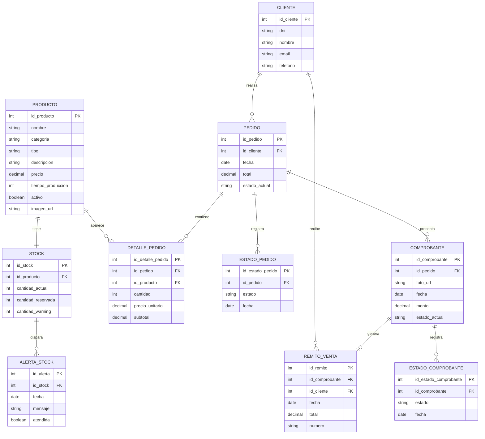
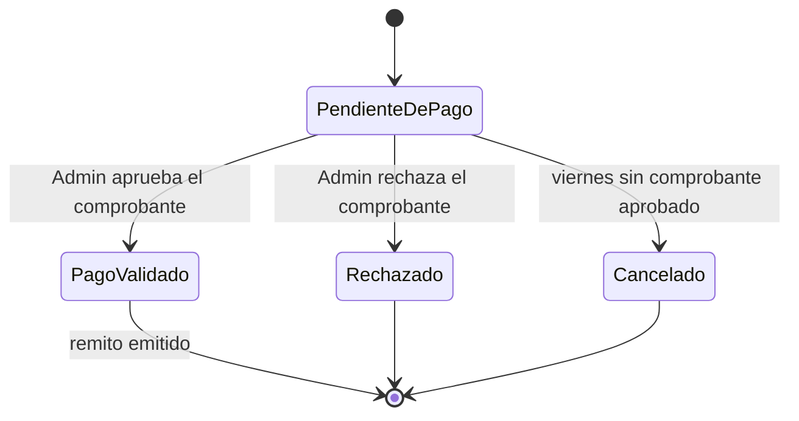
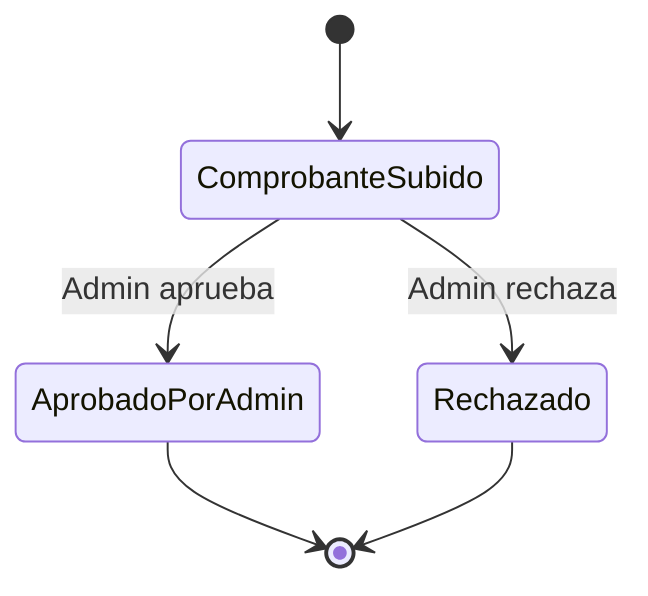
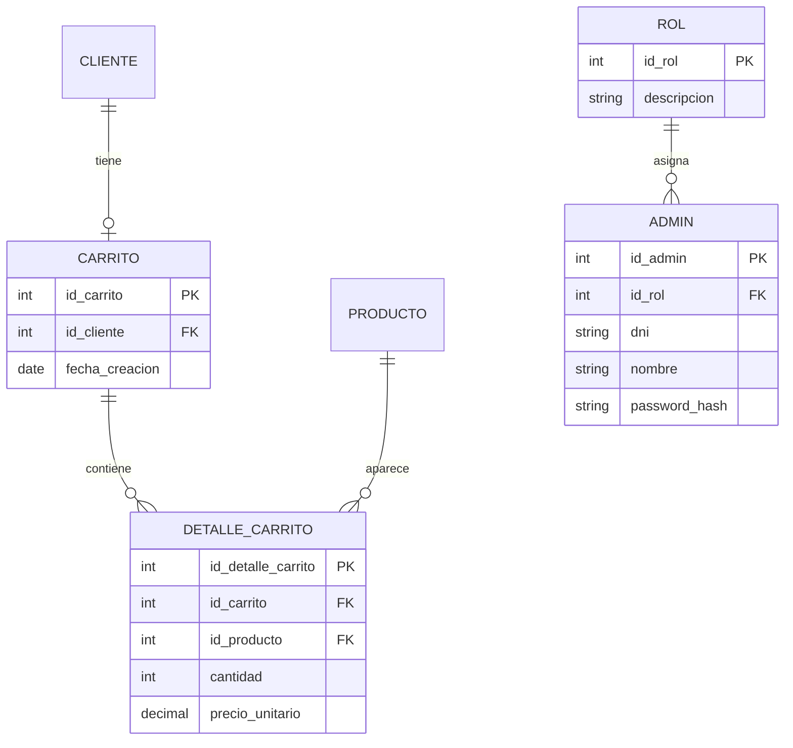
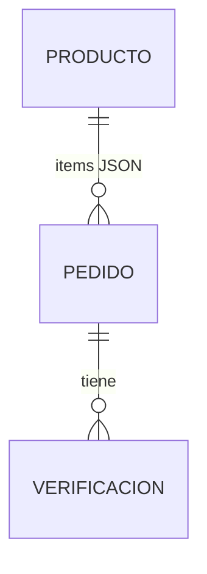

# Modelo de dominio · MVP

> **Estado:** aprobado el 2026-10-22.
> **Decisiones:** modelo normalizado; MVP sin envío; carrito en cliente con cookies; Admin con Basic Auth; remito HTML; tests con Vitest; validación manual sin IA.
> **Responsable de la base:** Isabella Infante (SQL). El brief para ella está en [`HANDOFF-ISABELLA.md`](HANDOFF-ISABELLA.md).
> **Criterio:** el código es la realidad operativa; el DER académico se adapta al código y ambos convergen en este modelo.

---

## 1. Alcance del MVP

**Incluye:**

- Catálogo de cosmética e higiene.
- Carrito en el cliente (cookie/localStorage), sin persistencia en Supabase.
- Pedido con reserva de stock.
- Comprobante con validación manual por los Administradores de Química.
- Remito de venta por email (HTML) al aprobar el comprobante.
- Panel `/admin` con pedidos, stock, alertas y remito.
- Alerta de stock en el panel, sin email al Administrador.

**No incluye (fase 2):**

- Envío, seguimiento o estados `En Preparación`, `Enviado`, `Entregado`.
- Cuentas de Cliente y carrito persistente en Supabase.
- Administradores en base (`ADMIN`/`ROL`); el MVP usa Basic Auth con `ADMIN_PASSWORD`.
- Validación por IA. En el sistema final no existe; el código legacy que la menciona se retira.

---

## 2. ERD del MVP

> Los nombres del ERD son lógicos. La tabla física puede conservar el plural actual
> (`estados_pedidos`, `estados_comprobante`, `remitos_de_venta`, `alerta_de_estado`); el mapeo está en
> [`HANDOFF-ISABELLA.md`](HANDOFF-ISABELLA.md).

---

## 3. Reglas de integridad

- **Una sola dirección por relación.** `STOCK.id_producto` (no `PRODUCTO.id_stock`), `ESTADO_PEDIDO.id_pedido` (no `PEDIDO.id_estado`). El carrito no tiene tablas en el MVP.
- **Estado actual + historial.** `PEDIDO.estado_actual` y `COMPROBANTE.estado_actual` son la lectura rápida del panel; `ESTADO_PEDIDO` y `ESTADO_COMPROBANTE` son el historial auditable. Se actualizan en la misma transacción.
- **Total derivado.** `PEDIDO.total = SUM(DETALLE_PEDIDO.subtotal)` y `DETALLE_PEDIDO.subtotal = cantidad × precio_unitario`.
- **Comprobante contra pedido.** `COMPROBANTE.monto` debe coincidir con `PEDIDO.total` para que el Admin pueda aprobar.
- **Reserva.** Al confirmar el pedido: `STOCK.cantidad_reservada += cantidad`. Al aprobar: `cantidad_actual -= cantidad` y `cantidad_reservada -= cantidad`. Al rechazar o vencer: solo `cantidad_reservada -= cantidad`.
- **Disponible.** `STOCK.cantidad_actual - STOCK.cantidad_reservada`; el umbral de aviso es `cantidad_warning`.
- **Remito.** Se genera al aprobar el comprobante; es el estado final del MVP. No hay envío ni seguimiento.
- **Borrado lógico.** `PRODUCTO.activo = false`; no se borran productos con historial.
- **Sin IA.** Los Administradores de Química comparan imagen y monto; no hay validación automática.
- **RLS.** Catálogo (`PRODUCTO`, `STOCK`) puede ser de lectura pública; `CLIENTE`, `PEDIDO`, `COMPROBANTE`, `REMITO` y `ALERTA` solo con service role o políticas por perfil. Ninguna escritura pública.

---

## 4. Estados canónicos del MVP

### 4.1 Pedido

**Valores:** `Pendiente de Pago`, `Pago Validado`, `Rechazado`, `Cancelado`.

`Pago Validado` es el estado final del MVP: descuenta stock, genera el remito y envía el email. No hay `En Preparación`, `Enviado` ni `Entregado`.

### 4.2 Comprobante

**Valores:** `Comprobante Subido`, `Aprobado por Admin`, `Rechazado`.

---

## 5. Fase 2 (no MVP)

Estas entidades existen en el DER académico y en la base nueva, pero el MVP no las usa. No se crean ni se migran en el primer sprint.

- **Carrito:** cookie/localStorage en el cliente; se persiste recién si hay cuentas.
- **Admin/ROL:** Basic Auth con `ADMIN_PASSWORD`; Supabase Auth queda para fase 2.
- **Envío:** fuera de alcance; el remito es el documento final.

---

## 6. Modelo alternativo (plano, código legacy)

Ventaja: es lo que hoy funciona contra el proyecto viejo. Desventajas: no hay `CLIENTE`, `COMPROBANTE`, `REMITO`, `STOCK` ni historial de estados; el stock es una columna del producto; la validación es por IA. **Descartado** porque contradice el DER académico y la base nueva.

---

## 7. Handoff a Isabella

El detalle de los cambios de DDL, constraints, índices, RLS y limpieza de datos está en
[`HANDOFF-ISABELLA.md`](HANDOFF-ISABELLA.md). Resumen:

1. Eliminar FKs recíprocas (`producto.id_stock`, `cliente.id_carrito`, `pedido.id_estado`).
2. Agregar `estado_actual` a `pedido` y `comprobante`; conservar las tablas de historial.
3. Normalizar `detalle_del_pedido` (PK propia, subtotal; sin estado/fecha/total duplicados).
4. Ajustar `producto` (nombre/descripción únicos, `activo`, `imagen_url`; sin FKs).
5. Ajustar `stock` (una fila por producto, `cantidad_actual`, `cantidad_reservada`, `cantidad_warning`).
6. Ajustar `comprobante` (`monto`, `foto_url`, `estado_actual`).
7. Ajustar `remitos_de_venta` (`numero`, sin `producto_selec`).
8. Simplificar `alerta_de_estado` (`mensaje`, `atendida`; sin email).
9. Dejar `admin`, `roll`, `detalle_carrito` para fase 2.
10. Definir RLS y limpiar los datos de prueba inconsistentes.

---

## 8. Decisiones cerradas

| Decisión | Resultado | Responsable |
|---|---|---|
| Modelo | Normalizado, ERD Mermaid | Isabella (SQL) |
| Estados MVP | Termina en `Pago Validado` + remito | Enzo |
| Envío | Fuera de alcance | Enzo |
| Carrito | Cliente, cookie/localStorage | Juanma |
| Admin | Basic Auth con `ADMIN_PASSWORD` | Enzo |
| Remito | HTML por email con Resend | Enzo |
| Tests | Vitest | Celeste |
| Validación | Manual por Administradores de Química | Enzo / Admin |

---

## 9. Implementación (2026-10-22)

El DDL ejecutable vive en `supabase/migrations/` y los tipos del front en `src/lib/database.types.ts`
(generados con `npm run db:types`). La auditoría y el runbook están en
[`AUDITORIA_BD.md`](AUDITORIA_BD.md); la decisión de reconstruir, en
[`adr/0004-reconstruccion-esquema-mvp.md`](adr/0004-reconstruccion-esquema-mvp.md).

Ajustes de implementación sobre este modelo. La columna *Cobertura* dice qué test lo fija; los que
dicen “decisión” son acuerdos de implementación, no invariantes que la base haga cumplir:

| Tema | Modelo | Implementación | Por qué | Cobertura |
|---|---|---|---|---|
| Historial `fecha` | `date` | `timestamptz` | Un `date` no permite ordenar dos cambios del mismo día. | `aprobacion.test.ts` (historial) |
| `cliente.email` | sin definir | único (`lower(email)`) | Evita clientes duplicados en checkout invitado. El DNI **no** es clave de identidad: solo valida formato (`^[0-9]{7,8}$`). | `contrato.test.ts` |
| Nombres físicos | lógicos en singular | plural actual (`estados_pedidos`, `remitos_de_venta`, `alerta_de_estado`) | Reduce la migración. | `contrato.test.ts` |
| `detalle_carrito` | fase 2 | se elimina (vacía) | El MVP no persiste carrito. | `contrato.test.ts` |
| `subtotal` / `total` | derivados | `subtotal` generado + trigger en `pedido` | La base garantiza el invariante. | `pedidos.test.ts` |
| Lectura del catálogo | — | vista `vista_catalogo` con `disponible` | Una sola forma de leer stock disponible. | `rls.test.ts` (HU-1) |
| Operaciones | — | RPC `crear_pedido`, `aprobar_comprobante`, `rechazar_comprobante`, `cancelar_pedidos_vencidos` | Transacciones atómicas y permisos por función. |
| Identidad del Cliente | — | el checkout lo resuelve por `email` desde el servidor (upsert con service role), sin RPC nueva | No hay RPC de Cliente en el contrato aprobado (4 RPC) y el único real es `email`. | decisión — spec `checkout` §6.1 |
| `comprobante.foto_url` | `string` | clave del objeto dentro del bucket privado; la signed URL se genera al leer | El bucket es privado: no hay URL pública que guardar. | decisión — spec `checkout` §6.2 |

