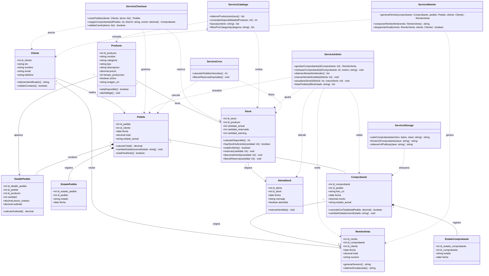

# Diagrama de Clases UML · Esencia Técnica

> **Proyecto:** Esencia Técnica — E-Commerce de Cosmética y Higiene (E.E.S.T N°1 Luciano Reyes).  
> **Cátedra:** Alejandro Nieva, Cecilia Maldonado, Ariel Leibouski.  
> **Entrega:** HU-1 (Nieva) / HU-14 del Spec Maestro de Cierre Beta ([`docs/specs/cierre-beta/spec.md`](../specs/cierre-beta/spec.md)).  
> **Fuentes de verdad:** [`docs/MODELO.md`](../MODELO.md) · [`GLOSSARY.md`](../../GLOSSARY.md) · [`docs/specs/cierre-beta/spec.md`](../specs/cierre-beta/spec.md).  
> **Responsables:** Isabella Infante (Modelado BD / Clases) y Juan Manuel Merodio (Arquitectura / Servicios).  
> **Estado:** Formalizado en Mermaid, alineado al código TypeScript y a la base de datos viva (`otjph…`).

---

## 1. Introducción y Marco Teórico de Cátedra (Nieva)

El Diagrama de Clases UML formaliza la arquitectura orientada a objetos de la plataforma **Esencia Técnica**. A diferencia de los borradores preliminares que mezclaban conceptos de persistencia relacional con definiciones de tablas ya descartadas, este modelo integra:

1. **Entidades de Dominio Canónicas:** Representan los conceptos esenciales del negocio escolar (comprador invitado, catálogo cosmético, inventario, pedidos, comprobantes de pago, remitos correlativos y alertas de stock).
2. **Servicios de Dominio (Domain Services):** Encapsulan la lógica de aplicación densa con interfaces reducidas y de alta cohesión (Checkout, Administración, Catálogo, Remito, Cron de Vencidos y Storage), desacoplando los componentes del front-end de la infraestructura de persistencia.
3. **Depuración de Entidades Históricas:** Se excluyen formalmente las entidades descartadas en ADR 0002 y ADR 0005:
   - No existe persistencia de `Carrito` ni `DetalleCarrito` en servidor (residen en el cliente).
   - No existen tablas de usuarios `Admin` ni `Rol` en la base de datos para el MVP (el acceso al panel `/admin` se gestiona mediante Basic Auth en Edge Middleware según ADR 0005).
   - No existe validación automatizada por IA ni servicios externos de machine learning (la validación de transferencias es 100% manual por el Administrador de Química).

---

## 2. Diagrama de Clases UML en Mermaid

---

## 3. Especificación de Entidades de Dominio

### 3.1. `Cliente`
Representa al comprador invitado en la tienda.
- **Atributos:**
  - `id_cliente` (int): Identificador unívoco generado por la base de datos.
  - `dni` (string): Documento Nacional de Identidad del comprador.
  - `nombre` (string): Nombre y apellido para rotulación y remito.
  - `email` (string): Casilla donde se despachará el Remito de venta.
  - `telefono` (string): Contacto telefónico para coordinar el retiro en la escuela.
- **Comportamiento:**
  - `obtenerIdentificador()`: Retorna la cédula o DNI formateado.
  - `validarContacto()`: Comprueba formato de correo electrónico y teléfono válido.

### 3.2. `Producto`
Artículo cosmético o de higiene elaborado en el laboratorio de Química.
- **Atributos:**
  - `id_producto` (int): Clave primaria.
  - `nombre` (string): Denominación del producto (ej. Jabón Líquido Neutro, Difusor Lavanda).
  - `categoria` (string): Agrupación funcional (Jabones, Cuidado Capilar, Aromatizantes).
  - `tipo` (string): Subtipo específico.
  - `descripcion` (string): Propiedades dermatológicas, fórmula y modo de empleo.
  - `precio` (decimal): Valor unitario en pesos argentinos (`precio > 0`).
  - `tiempo_produccion` (int): Días de maceración o elaboración en laboratorio.
  - `activo` (boolean): Flag de baja lógica (`activo = false`); los productos con historial de ventas nunca se borran físicamente.
  - `imagen_url` (string): URL pública alojada en el bucket `productos` de Supabase Storage.
- **Comportamiento:**
  - `estaDisponible()`: Retorna verdadero si el producto está activo y su stock disponible supera cero.
  - `darDeBaja()`: Asigna `activo = false`.

### 3.3. `Stock`
Control de inventario y cantidades disponibles en el taller.
- **Atributos:**
  - `id_stock` (int): Clave primaria.
  - `id_producto` (int): Clave foránea referenciando a `Producto`.
  - `cantidad_actual` (int): Unidades físicas en estantería.
  - `cantidad_reservada` (int): Unidades comprometidas en pedidos `Pendiente de Pago`.
  - `cantidad_warning` (int): Umbral de aviso de stock mínimo.
- **Comportamiento:**
  - `calcularDisponible()`: Retorna `cantidad_actual - cantidad_reservada`.
  - `hayStockSuficiente(cantidad)`: Comprueba si `calcularDisponible() >= cantidad`.
  - `estaEnAlerta()`: Comprueba si `calcularDisponible() <= cantidad_warning`.
  - `reservar(cantidad)`: Incrementa `cantidad_reservada` al confirmar pedido.
  - `descontarVenta(cantidad)`: Reduce `cantidad_actual` y `cantidad_reservada` al aprobar el comprobante.
  - `liberarReserva(cantidad)`: Reduce `cantidad_reservada` al rechazar o cancelar por cron.

### 3.4. `Pedido`
Orden de compra registrada por un cliente.
- **Atributos:**
  - `id_pedido` (int): Clave primaria.
  - `id_cliente` (int): Clave foránea al comprador.
  - `fecha` (date): Momento cronológico de confirmación.
  - `total` (decimal): Monto consolidado, derivado de la suma de subtotales.
  - `estado_actual` (string): Estado canónico (`Pendiente de Pago`, `Pago Validado`, `Rechazado`, `Cancelado`).
- **Comportamiento:**
  - `calcularTotal()`: Recalcula la suma de los subtotales de sus líneas de detalle.
  - `cambiarEstado(nuevoEstado)`: Transiciona de estado persistiendo en `EstadoPedido`.
  - `estaPendiente()`: Indica si aguarda validación de comprobante.

### 3.5. `DetallePedido`
Línea individual de un pedido con referencia a producto y precio histórico congelado.
- **Atributos:**
  - `id_detalle_pedido` (int): Clave primaria.
  - `id_pedido` (int): Vínculo con la orden padre.
  - `id_producto` (int): Vínculo con el artículo.
  - `cantidad` (int): Cantidad solicitada (`cantidad > 0`).
  - `precio_unitario` (decimal): Precio al momento exacto de la compra.
  - `subtotal` (decimal): Producto de `cantidad * precio_unitario`.
- **Comportamiento:**
  - `calcularSubtotal()`: Multiplica cantidad por precio unitario con redondeo a centavos.

### 3.6. `EstadoPedido`
Historial cronológico de cambios de estado del pedido para trazabilidad y auditoría.
- **Atributos:**
  - `id_estado_pedido` (int): Clave primaria.
  - `id_pedido` (int): Clave foránea al pedido.
  - `estado` (string): Nombre canónico del estado asignado.
  - `fecha` (date): Timestamp de la transición.

### 3.7. `Comprobante`
Constancia de transferencia bancaria aportada por el cliente.
- **Atributos:**
  - `id_comprobante` (int): Clave primaria.
  - `id_pedido` (int): Clave foránea al pedido correspondiente.
  - `foto_url` (string): Identificador/clave del archivo en el bucket privado de Storage.
  - `fecha` (date): Fecha de subida.
  - `monto` (decimal): Importe transferido informado por el cliente (`monto > 0`).
  - `estado_actual` (string): Estado canónico (`Comprobante Subido`, `Aprobado por Admin`, `Rechazado`).
- **Comportamiento:**
  - `coincideConTotal(totalPedido)`: Valida que `monto == totalPedido` para habilitar la aprobación manual.
  - `cambiarEstado(nuevoEstado)`: Actualiza el estado actual e inserta registro en `EstadoComprobante`.

### 3.8. `EstadoComprobante`
Historial de auditoría de revisiones sobre el comprobante.
- **Atributos:**
  - `id_estado_comprobante` (int): Clave primaria.
  - `id_comprobante` (int): Clave foránea al comprobante.
  - `estado` (string): Estado asignado (`Comprobante Subido`, `Aprobado por Admin`, `Rechazado`).
  - `fecha` (date): Timestamp de la revisión.

### 3.9. `RemitoVenta`
Documento de entrega emitido tras la validación exitosa del comprobante.
- **Atributos:**
  - `id_remito` (int): Clave primaria.
  - `id_comprobante` (int): Vínculo unívoco con el comprobante que originó la venta.
  - `id_cliente` (int): Vínculo con el destinatario.
  - `fecha` (date): Momento de emisión.
  - `total` (decimal): Importe final comercializado.
  - `numero` (string): Secuencia correlativa oficial (ej. `R-2026-000001`).
- **Comportamiento:**
  - `generarNumero()`: Aplica la máscara y correlatividad anual de venta.
  - `obtenerEncabezado()`: Formatea los datos institucionales de la escuela y taller.

### 3.10. `AlertaStock`
Registro de incidencia ante inventario por debajo del umbral mínimo.
- **Atributos:**
  - `id_alerta` (int): Clave primaria.
  - `id_stock` (int): Clave foránea al inventario afectado.
  - `fecha` (date): Momento de detección de stock bajo.
  - `mensaje` (string): Descripción operativa para el Administrador.
  - `atendida` (boolean): Flag de gestión en panel (`false` = pendiente de atención).
- **Comportamiento:**
  - `marcarAtendida()`: Modifica el flag a `true`.

---

## 4. Especificación de Servicios de Dominio

### 4.1. `ServicioCheckout`
Coordina la confirmación del pedido, la reserva de stock y el registro del comprobante.
- `crearPedido(cliente, items)`: Valida disponibilidad, reserva cantidades, crea registro de cliente si no existe, inserta cabecera e ítems en una única transacción PostgreSQL y retorna el `Pedido` en `Pendiente de Pago`.
- `cargarComprobante(idPedido, fotoUrl, monto)`: Inserta comprobante en estado `Comprobante Subido` vinculado al pedido.
- `validarCarrito(items)`: Comprueba que el carrito del navegador no esté vacío ni posea cantidades no positivas o productos repetidos.

### 4.2. `ServicioCatalogo`
Proporciona la vista pública de artículos cosméticos.
- `obtenerProductosActivos()`: Consulta la vista optimizada `vista_catalogo` retornando únicamente artículos con `activo = true`.
- `consultarDisponibilidad(idProducto)`: Obtiene el saldo disponible restando reservas vigentes.
- `buscar(criterio)`: Búsqueda declarativa insensible a mayúsculas y acentos sobre nombre, categoría y descripción.
- `filtrarPorCategoria(categoria)`: Filtra productos activos pertenecientes a la categoría seleccionada.

### 4.3. `ServicioAdmin`
Encapsula la operativa de validación y control de stock exclusiva de los Administradores de Química.
- `aprobarComprobante(idComprobante)`: Ejecuta RPC atómica `aprobar_comprobante`, pasando el pedido a `Pago Validado`, el comprobante a `Aprobado por Admin`, descontando el stock físico, liberando la reserva y emitiendo el `RemitoVenta`.
- `rechazarComprobante(idComprobante, motivo)`: Ejecuta RPC `rechazar_comprobante`, pasando el pedido a `Rechazado`, liberando la reserva de stock y registrando el motivo.
- `obtenerAlertasSinAtender()`: Retorna listado de alertas de stock para visualización en popup del panel.
- `marcarAlertaAtendida(idAlerta)`: Registra la resolución del aviso de inventario.
- `actualizarStock(idStock, nuevoStock)`: Ajusta los niveles físicos o umbrales mínimos.
- `listarPedidos(filtroEstado)`: Consulta pedidos con sus comprobantes y detalles para revisión en `/admin`.

### 4.4. `ServicioRemito`
Gestiona la emisión gráfica y despacho del comprobante de venta.
- `generarRemito(comprobante, pedido, cliente)`: Construye la estructura de datos del remito con productos y precios congelados.
- `componerRemitoHtml(remito)`: Genera el documento HTML institucional apto para impresión y lectura móvil.
- `despacharEmail(remito, cliente)`: Invoca la API de Resend para entregar el correo electrónico al cliente con remitente verificado (proceso posterior no bloqueante).

### 4.5. `ServicioCron`
Automatización periódica de mantenimiento de stock y pedidos expirados.
- `cancelarPedidosVencidos()`: Invocado de manera programada los **viernes a las 23:59 ART**, ejecuta la RPC `cancelar_pedidos_vencidos` que cancela pedidos en `Pendiente de Pago`, rechaza comprobantes asociados y libera las unidades reservadas devolviéndolas a la venta.
- `liberarReservasExpiradas()`: Asegura idempotencia en la liberación de stock.

### 4.6. `ServicioStorage`
Gestor de persistencia de archivos binarios e imágenes en Supabase Storage.
- `subirComprobante(archivo, clave)`: Sube imagen de comprobante al bucket privado `comprobantes`.
- `firmarUrlComprobante(clave)`: Genera una URL firmada de tiempo limitado (60 segundos) para que el Administrador de Química pueda inspeccionar el pago en `/admin`.
- `obtenerUrlPublica(clave)`: Obtiene el enlace directo a las fotos de productos en el bucket público `productos`.

---

## 5. Trazabilidad con `docs/MODELO.md` y Auditoría DDL

| Clase UML | Tabla / Vista en Base de Datos | Migración DDL |
|---|---|---|
| `Cliente` | `cliente` | `01_tablas_principales.sql` |
| `Producto` | `producto` (`vista_catalogo`) | `01_tablas_principales.sql` / `02_vistas.sql` |
| `Stock` | `stock` | `01_tablas_principales.sql` |
| `Pedido` | `pedido` | `01_tablas_principales.sql` |
| `DetallePedido` | `detalle_pedido` | `01_tablas_principales.sql` |
| `EstadoPedido` | `estados_pedidos` | `01_tablas_principales.sql` |
| `Comprobante` | `comprobante` | `01_tablas_principales.sql` |
| `EstadoComprobante` | `estados_comprobante` | `01_tablas_principales.sql` |
| `RemitoVenta` | `remitos_de_venta` | `01_tablas_principales.sql` |
| `AlertaStock` | `alerta_de_estado` | `01_tablas_principales.sql` |
| `ServicioCheckout` | RPC `crear_pedido` | `03_funciones_transacciones.sql` |
| `ServicioAdmin` | RPC `aprobar_comprobante` / `rechazar_comprobante` | `03_funciones_transacciones.sql` |
| `ServicioCron` | RPC `cancelar_pedidos_vencidos` | `03_funciones_transacciones.sql` |
| `ServicioStorage` | Buckets `productos` y `comprobantes` | `05_storage.sql` |
