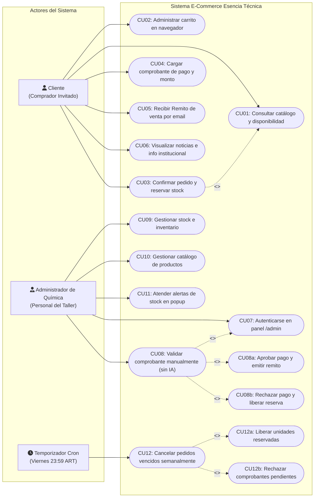

# Diagrama de Casos de Uso (DCU) · Esencia Técnica

> **Proyecto:** Esencia Técnica — E-Commerce de Cosmética y Higiene (E.E.S.T N°1 Luciano Reyes).  
> **Cátedra:** Alejandro Nieva, Cecilia Maldonado, Ariel Leibouski.  
> **Entrega:** HU-2 (Celeste) / HU-11 del Spec Maestro de Cierre Beta ([`docs/specs/cierre-beta/spec.md`](../specs/cierre-beta/spec.md)).  
> **Fuentes de verdad:** [`docs/MODELO.md`](../MODELO.md) · [`GLOSSARY.md`](../../GLOSSARY.md) · [`docs/adr/0002-validacion-manual-sin-ia.md`](../adr/0002-validacion-manual-sin-ia.md).  
> **Responsables:** Celeste Cáceres (Diseño UX/UI & QA) y Juan Manuel Merodio (Arquitectura).  
> **Estado:** Formalizado en Mermaid, alineado a la validación manual sin IA y a la arquitectura del MVP.

---

## 1. Introducción y Ajuste de Alcance Docente

El Diagrama de Casos de Uso (DCU) delimita las interacciones funcionales entre los actores humanos y automatizados con el sistema **Esencia Técnica**. Este documento actualiza y reemplaza el borrador preliminar en CSV ([`DCU-Quimica.csv`](DCU-Quimica.csv)), subsanando inconsistencias de alcance:

1. **Validación 100% Manual por el Administrador (Sin IA):**
   - Conforme al [ADR 0002](../adr/0002-validacion-manual-sin-ia.md), se descarta de forma definitiva la verificación bancaria por IA.
   - El caso de uso central de validación es ejecutado por el **Administrador de Química** en `/admin`, quien coteja visualmente la captura del comprobante bancario contra el monto exacto del pedido registrado en la base de datos.
2. **El Carrito de Compras reside en el Cliente:**
   - La administración del carrito es una interacción de front-end en el navegador (`localStorage` / cookies). No interactúa con la base de datos de Supabase ni bloquea stock hasta que el cliente confirma la compra.
3. **Frontera del MVP (Sin Envío Físico):**
   - El ciclo de venta concluye en el estado `Pago Validado` con la emisión y entrega del **Remito de venta** por correo electrónico para retiro en el taller escolar (Int. Moro 1122, Campana). No existen casos de uso de logística ni estados de despacho postal.
4. **Actor Temporizador (Cron de los Viernes 23:59 ART):**
   - Se incorpora formalmente el actor de sistema automatizado (Vercel Cron) encargado de ejecutar la cancelación de pedidos impagos y la liberación de la reserva semanal.

---

## 2. Diagrama de Casos de Uso en Mermaid

---

## 3. Especificación Detallada de Casos de Uso

### CU01 · Consultar catálogo y disponibilidad
- **Actor principal:** Cliente.
- **Precondición:** Ninguna (acceso público).
- **Flujo principal:**
  1. El cliente accede a la tienda (`/` o `/about`).
  2. El sistema recupera los productos activos desde `vista_catalogo`.
  3. El cliente filtra por categoría o ingresa palabras clave de búsqueda.
  4. El sistema presenta nombre, tipo, descripción, precio y stock disponible (`cantidad_actual - cantidad_reservada`).
- **Postcondición:** El cliente visualiza artículos y su disponibilidad en tiempo real.

### CU02 · Administrar carrito en navegador
- **Actor principal:** Cliente.
- **Precondición:** Artículos disponibles en catálogo.
- **Flujo principal:**
  1. El cliente agrega productos, incrementa o reduce cantidades dentro del límite de stock disponible.
  2. El carrito se actualiza y persiste en `localStorage` o cookies del navegador.
- **Postcondición:** El total a pagar se computa localmente sin interactuar con la base de datos de Supabase.

### CU03 · Confirmar pedido y reservar stock
- **Actor principal:** Cliente.
- **Precondición:** Carrito no vacío y datos de contacto ingresados (DNI, nombre, email, teléfono).
- **Flujo principal:**
  1. El cliente envía el formulario en `/checkout`.
  2. El sistema valida stock suficiente en base de datos.
  3. Se inserta el `Cliente`, se genera el `Pedido` en estado `Pendiente de Pago` y se registran los ítems en `DetallePedido`.
  4. La transacción atómica incrementa `STOCK.cantidad_reservada` y registra el historial en `ESTADO_PEDIDO`.
  5. El sistema devuelve los datos bancarios oficiales de la Cooperadora (CBU, Alias).
- **Postcondición:** El pedido queda registrado y las unidades quedan reservadas.

### CU04 · Cargar comprobante de pago y monto
- **Actor principal:** Cliente.
- **Precondición:** Pedido confirmado en estado `Pendiente de Pago`.
- **Flujo principal:**
  1. El cliente selecciona la imagen del comprobante de transferencia y declara el monto abonado (`monto > 0`).
  2. El sistema almacena la fotografía en el bucket privado `comprobantes` de Supabase Storage.
  3. Se registra la fila en `COMPROBANTE` en estado `Comprobante Subido` y su correspondiente `ESTADO_COMPROBANTE`.
- **Postcondición:** El comprobante queda disponible para su inspección por el Administrador.

### CU05 · Recibir Remito de venta por email
- **Actor principal:** Cliente.
- **Precondición:** Comprobante aprobado por el Administrador de Química.
- **Flujo principal:**
  1. El sistema genera el `RemitoVenta` correlativo (`R-2026-XXXXXX`).
  2. Se despacha un correo electrónico con plantilla HTML mediante Resend con los detalles del pedido, remitente institucional y constancia de retiro.
- **Postcondición:** El cliente cuenta con la constancia formal para presentarse en el taller.

### CU06 · Visualizar noticias e info institucional
- **Actor principal:** Cliente.
- **Precondición:** Ninguna.
- **Flujo principal:**
  1. El cliente navega por la sección institucional y consulta historia del taller, ubicación y novedades.

### CU07 · Autenticarse en panel `/admin`
- **Actor principal:** Administrador de Química.
- **Precondición:** Conocer la clave institucional (`ADMIN_PASSWORD`).
- **Flujo principal:**
  1. El operador ingresa a `/admin`.
  2. El Edge Middleware intercepta la petición y exige Basic Auth.
  3. Ante credenciales válidas, se permite el acceso al panel operativo.

### CU08 · Validar comprobante manualmente (sin IA)
- **Actor principal:** Administrador de Química.
- **Precondición:** Existencia de pedidos con `Comprobante Subido`.
- **Flujo principal:**
  1. El Administrador abre el pedido en el panel `/admin`.
  2. El sistema genera una URL firmada de 60 segundos para visualizar la captura del comprobante.
  3. El Administrador coteja que el comprobante sea legítimo y que el monto coincida con `PEDIDO.total`.
  4. **Subflujo CU08a (Aprobación):** El Administrador presiona "Aprobar". La base de datos descuenta `cantidad_actual`, libera `cantidad_reservada`, pasa el pedido a `Pago Validado` y emite el `RemitoVenta`.
  5. **Subflujo CU08b (Rechazo):** El Administrador presiona "Rechazar". El pedido pasa a `Rechazado`, se libera la reserva y no se altera el stock físico.

### CU09 · Gestionar stock e inventario
- **Actor principal:** Administrador de Química.
- **Precondición:** Autenticado en `/admin`.
- **Flujo principal:**
  1. El Administrador consulta las existencias físicas, cantidades reservadas y disponibles.
  2. Actualiza unidades físicas tras elaboraciones en laboratorio o ajusta el stock mínimo de aviso (`cantidad_warning`).

### CU10 · Gestionar catálogo de productos
- **Actor principal:** Administrador de Química.
- **Precondición:** Autenticado en `/admin`.
- **Flujo principal:**
  1. El Administrador edita precios, descripciones o sube nuevas fotografías al bucket público.
  2. Puede dar de baja lógica un producto asignando `activo = false` sin destruir su historial comercial.

### CU11 · Atender alertas de stock en popup
- **Actor principal:** Administrador de Química.
- **Precondición:** Productos con saldo disponible por debajo del stock mínimo.
- **Flujo principal:**
  1. Al acceder a `/admin`, el panel despliega un popup informativo de alerta de stock.
  2. El Administrador toma conocimiento y marca la alerta como atendida (`atendida = true`).
  3. No se envían correos electrónicos intrusivos al operador.

### CU12 · Cancelar pedidos vencidos semanalmente
- **Actor principal:** Temporizador Cron (Vercel Cron).
- **Precondición:** Viernes 23:59 ART y presencia del token `CRON_SECRET`.
- **Flujo principal:**
  1. El servicio invoca `POST /api/cron/vencidos`.
  2. Se invoca la función `cancelar_pedidos_vencidos` en la base de datos.
  3. Todos los pedidos en `Pendiente de Pago` pasan a `Cancelado`.
  4. Sus comprobantes pendientes pasan a `Rechazado`.
  5. Se liberan automáticamente todas las unidades reservadas (`cantidad_reservada -= cantidad`).
- **Postcondición:** El stock reservado no abonado queda reintegrado para la venta del fin de semana.

---

## 4. Trazabilidad con el Borrador Histórico

| Caso de Uso Original (`DCU-Quimica.csv`) | Estado en el Modelo Canónico | Justificación Técnica |
|---|---|---|
| *Generar carrito* | En cliente (`localStorage`) | No persiste en BD en el MVP para evitar sobrecarga y sesiones anónimas complejas. |
| *Confirmar pedido* | CU03 (Reserva atómica) | Implementado con RPC PostgreSQL garantizando reserva de stock. |
| *Cargar comprobante* | CU04 (Storage privado) | Comprobante protegido en bucket privado con URL firmada. |
| *Validar comprobante con IA* | **Deprecado** -> Reemplazado por CU08 (Manual) | ADR 0002: verificación humana docente sin cajas negras. |
| *Recibir alertas por email* | **Deprecado** -> Reemplazado por CU11 (Popup) | Las alertas son exclusivas del panel `/admin` sin spam por email. |
| *Recibir remito de entrega* | CU05 (HTML por Resend) | Envío formal de remito con número correlativo único. |
