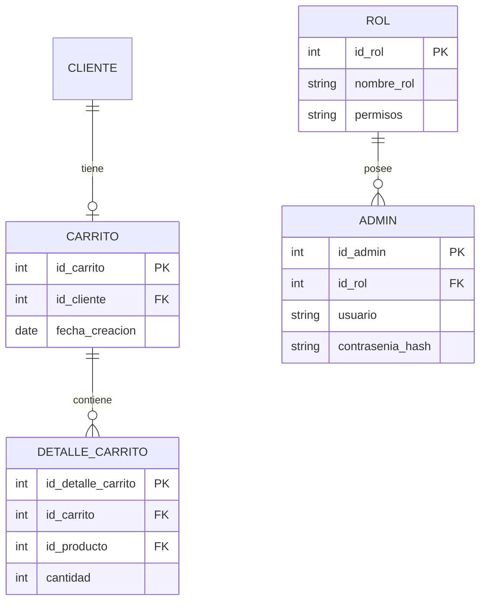

# Diagrama Entidad-Relación (DER) · Esencia Técnica

> **Proyecto:** Esencia Técnica — E-Commerce de Cosmética y Higiene (E.E.S.T N°1 Luciano Reyes).  
> **Cátedra:** Alejandro Nieva, Cecilia Maldonado, Ariel Leibouski.  
> **Entrega:** Entregable Académico de Cierre Beta ([`docs/specs/cierre-beta/spec.md`](../specs/cierre-beta/spec.md)).  
> **Fuentes de verdad:** [`docs/MODELO.md`](../MODELO.md) · [`docs/estado/AUDITORIA_BD.md`](../estado/AUDITORIA_BD.md) · [`GLOSSARY.md`](../../GLOSSARY.md).  
> **Responsables:** Isabella Infante (SQL / DDL) y Juan Manuel Merodio (Arquitectura).  
> **Estado:** Formalizado en Mermaid, 100% normalizado en 3FN y en concordancia con la base viva (`otjph…`).

---

## 1. Introducción y Resolución del Borrador Histórico

El borrador preliminar en formato CSV ([`DER-quimica.csv`](DER-quimica.csv)) representó la primera aproximación al modelado de datos del proyecto. Sin embargo, presentaba discrepancias con las buenas prácticas de normalización relacional y desajustes respecto al código operativo en producción:

1. **Inversión y Circularidad de Claves Foráneas:**
   - *Borrador preliminar:* Colocaba `id_stock` en la tabla de productos y simultáneamente `id_producto` en stock. Lo mismo sucedía entre pedidos y comprobantes.
   - *Resolución canónica:* Una sola dirección por relación jerárquica. La tabla `STOCK` almacena la clave foránea `id_producto` referenciando a `PRODUCTO`. La tabla `COMPROBANTE` referencia a `PEDIDO`.
2. **Diferenciación entre Estado Actual e Historial de Auditoría:**
   - *Borrador preliminar:* Intentaba almacenar un único campo de estado sin preservar la trazabilidad temporal.
   - *Resolución canónica:* Modelo dual optimizado. `PEDIDO.estado_actual` y `COMPROBANTE.estado_actual` permiten lectura directa en el panel de control, mientras que las tablas `ESTADO_PEDIDO` y `ESTADO_COMPROBANTE` auditan cada cambio en la misma transacción atómica con su timestamp.
3. **Tipificación Financiera Estricta:**
   - *Borrador preliminar:* Utilizaba tipos genéricos `int(200)` o `varchar` para precios y montos.
   - *Resolución canónica:* Toda cifra monetaria se modela como `NUMERIC(12,2)` en PostgreSQL con restricciones `CHECK (precio > 0)` y `CHECK (monto > 0)`.
4. **Frontera Nítida entre Fase 1 (MVP) y Fase 2:**
   - *Resolución de cátedra:* Se formaliza el DER del MVP con 10 tablas activas en la base `otjph…`. Las entidades de usuarios administrativos (`ADMIN`, `ROL`) y carrito persistente (`CARRITO`, `DETALLE_CARRITO`) quedan explícitamente delimitadas como extensiones de Fase 2.
5. **Nombres lógicos contra nombres físicos (auditoría del 2026-11-05):**
   - *Borrador anterior:* El DER dibujaba 10 entidades en singular y mayúsculas (`CLIENTE`, `ESTADO_PEDIDO`, `REMITO_VENTA`…) mientras la base viva tenía tablas con otros nombres y columnas que el diagrama no mostraba. Esa brecha es peligrosa: un diagrama que no coincide con la base hace creer que el esquema es otro.
   - *Resolución canónica:* El DER usa **los nombres físicos exactos** de `public`, con **todas** las columnas, su tipo SQL y sus reglas. Se verificó contra el proyecto vivo por la especificación OpenAPI de PostgREST (con la service role key) y quedó fijado por `tests/front/der-paridad-esquema.test.ts`, que compara el diagrama contra el DDL ejecutable tabla por tabla, columna por columna y clave foránea por clave foránea.
   - *Resultado:* 13 objetos — 10 tablas del MVP, las 2 tablas del residuo de Fase 2 que siguen vivas (`admin`, `roll`, cerradas por RLS) y la vista `vista_catalogo`.

---

## 2. Diagrama Entidad-Relación en Mermaid (esquema físico de la base viva)

```mermaid
erDiagram
    %% Nombres físicos exactos del esquema public en la base viva otjphjnrwihqzzhbfnmh.
    %% Auditado el 2026-11-05 por la especificación OpenAPI de PostgREST.

    cliente ||--o{ pedido : "realiza"
    cliente ||--o{ remitos_de_venta : "recibe"

    producto ||--|| stock : "tiene"
    producto ||--o{ detalle_del_pedido : "aparece en"

    pedido ||--o{ detalle_del_pedido : "contiene"
    pedido ||--o{ estados_pedidos : "registra"
    pedido ||--o{ comprobante : "presenta"

    comprobante ||--o{ estados_comprobante : "registra"
    comprobante ||--o| remitos_de_venta : "genera"

    stock ||--o{ alerta_de_estado : "dispara"

    cliente {
        int id_cliente PK "INTEGER IDENTITY"
        string dni "TEXT NOT NULL · CHECK (dni ~ '^[0-9]{7,8}$')"
        string nombre "TEXT NOT NULL · CHECK (btrim(nombre) <> '')"
        string email "TEXT NOT NULL · UNIQUE (lower(email))"
        string telefono "TEXT NULL"
        timestamp creado_en "TIMESTAMPTZ NOT NULL DEFAULT now()"
    }

    producto {
        int id_producto PK "INTEGER IDENTITY"
        string nombre "TEXT NOT NULL · UNIQUE (lower(nombre)) WHERE activo"
        string categoria "TEXT NOT NULL"
        string tipo "TEXT NOT NULL"
        string descripcion "TEXT NOT NULL DEFAULT ''"
        numeric precio "NUMERIC(12,2) NOT NULL · CHECK (precio > 0)"
        int tiempo_produccion "INTEGER NOT NULL DEFAULT 0 · CHECK (>= 0)"
        boolean activo "BOOLEAN NOT NULL DEFAULT true · baja logica"
        string imagen_url "TEXT NULL · bucket publico productos"
        timestamp creado_en "TIMESTAMPTZ NOT NULL DEFAULT now()"
        timestamp actualizado_en "TIMESTAMPTZ NOT NULL DEFAULT now()"
    }

    stock {
        int id_stock PK "INTEGER IDENTITY"
        int id_producto FK "INTEGER NOT NULL UNIQUE · 1:1 con producto"
        int cantidad_actual "INTEGER NOT NULL DEFAULT 0 · CHECK (>= 0)"
        int cantidad_reservada "INTEGER NOT NULL DEFAULT 0 · ET007 <= cantidad_actual"
        int cantidad_warning "INTEGER NOT NULL DEFAULT 0 · 0 = sin umbral"
        timestamp actualizado_en "TIMESTAMPTZ NOT NULL DEFAULT now()"
    }

    pedido {
        int id_pedido PK "INTEGER IDENTITY"
        int id_cliente FK "INTEGER NOT NULL"
        date fecha "DATE NOT NULL DEFAULT current_date"
        numeric total "NUMERIC(12,2) NOT NULL · = SUM(detalle.subtotal)"
        string estado_actual "TEXT NOT NULL · 4 estados canonicos"
        timestamp creado_en "TIMESTAMPTZ NOT NULL DEFAULT now()"
        timestamp actualizado_en "TIMESTAMPTZ NOT NULL DEFAULT now()"
    }

    detalle_del_pedido {
        int id_detalle_pedido PK "INTEGER IDENTITY"
        int id_pedido FK "INTEGER NOT NULL · UNIQUE (id_pedido, id_producto)"
        int id_producto FK "INTEGER NOT NULL"
        int cantidad "INTEGER NOT NULL · CHECK (cantidad > 0)"
        numeric precio_unitario "NUMERIC(12,2) NOT NULL · CHECK (>= 0)"
        numeric subtotal "NUMERIC(12,2) GENERATED ALWAYS AS (cantidad * precio_unitario) STORED"
    }

    estados_pedidos {
        int id_estado_pedido PK "INTEGER IDENTITY"
        int id_pedido FK "INTEGER NOT NULL"
        string estado "TEXT NOT NULL · 4 estados canonicos"
        timestamp fecha "TIMESTAMPTZ NOT NULL DEFAULT clock_timestamp()"
    }

    comprobante {
        int id_comprobante PK "INTEGER IDENTITY"
        int id_pedido FK "INTEGER NOT NULL · UNIQUE WHERE pendiente"
        string foto_url "TEXT NOT NULL · bucket privado comprobantes"
        date fecha "DATE NOT NULL DEFAULT current_date"
        numeric monto "NUMERIC(12,2) NOT NULL · CHECK (monto > 0)"
        string estado_actual "TEXT NOT NULL · 3 estados canonicos"
        timestamp subido_en "TIMESTAMPTZ NOT NULL DEFAULT now()"
    }

    estados_comprobante {
        int id_estado_comprobante PK "INTEGER IDENTITY"
        int id_comprobante FK "INTEGER NOT NULL"
        string estado "TEXT NOT NULL · 3 estados canonicos"
        timestamp fecha "TIMESTAMPTZ NOT NULL DEFAULT clock_timestamp()"
    }

    remitos_de_venta {
        int id_remito PK "INTEGER IDENTITY"
        int id_comprobante FK "INTEGER NOT NULL UNIQUE · un remito por comprobante"
        int id_cliente FK "INTEGER NOT NULL"
        date fecha "DATE NOT NULL DEFAULT current_date"
        numeric total "NUMERIC(12,2) NOT NULL · CHECK (>= 0)"
        string numero "TEXT NOT NULL UNIQUE · R-YYYY-NNNNNN"
    }

    alerta_de_estado {
        int id_alerta PK "INTEGER IDENTITY"
        int id_stock FK "INTEGER NOT NULL · UNIQUE WHERE NOT atendida"
        timestamp fecha "TIMESTAMPTZ NOT NULL DEFAULT clock_timestamp()"
        string mensaje "TEXT NOT NULL"
        boolean atendida "BOOLEAN NOT NULL DEFAULT false"
    }

    %% Fase 2 residual: existen en la base viva, ninguna migración las crea y quedan cerradas.
    admin {
        int id_admin PK "INTEGER IDENTITY"
        string nombre "VARCHAR(100) NOT NULL"
        string email "VARCHAR(100) NOT NULL"
        string password_hash "VARCHAR(255) NOT NULL · hash, nunca texto plano"
    }

    roll {
        int id_rol PK "INTEGER IDENTITY"
        string descripcion_rol "VARCHAR(50) NOT NULL"
    }

    %% VISTA (no tabla) con security_invoker: una sola forma de leer el catalogo y el disponible.
    %% No tiene claves ni relaciones: se calcula sobre producto y stock.
    vista_catalogo {
        int id_producto "producto.id_producto"
        string nombre "producto.nombre"
        string categoria "producto.categoria"
        string tipo "producto.tipo"
        string descripcion "producto.descripcion"
        numeric precio "producto.precio"
        int tiempo_produccion "producto.tiempo_produccion"
        string imagen_url "producto.imagen_url"
        int cantidad_actual "coalesce(stock.cantidad_actual, 0)"
        int cantidad_reservada "coalesce(stock.cantidad_reservada, 0)"
        int disponible "greatest(cantidad_actual - cantidad_reservada, 0)"
        int cantidad_warning "coalesce(stock.cantidad_warning, 0)"
    }
```

---

## 3. Diccionario de Entidades y Reglas de Integridad

> Los nombres son los físicos de `public`. Los tipos son los reales de PostgreSQL; el diagrama los
> abrevia con el vocabulario de Mermaid (`string` = `text`/`character varying`, `int` = `integer`,
> `timestamp` = `timestamp with time zone`).

### 3.1. `cliente`
Comprador invitado en la tienda. No requiere registro previo ni contraseña en el MVP.
- `id_cliente` (INTEGER IDENTITY / PK): Identificador autoincremental.
- `dni` (TEXT NOT NULL): DNI del comprador; `CHECK (dni ~ '^[0-9]{7,8}$')`. **No** es clave de identidad.
- `nombre` (TEXT NOT NULL): Nombre completo del destinatario; no puede quedar vacío.
- `email` (TEXT NOT NULL): Correo para el remito; **único** por `lower(email)`, es la identidad real del checkout invitado.
- `telefono` (TEXT NULL): Teléfono de contacto; opcional.
- `creado_en` (TIMESTAMPTZ NOT NULL DEFAULT now()): Alta del Cliente.

### 3.2. `producto`
Catálogo de formulaciones cosméticas elaboradas en el taller de Química.
- `id_producto` (INTEGER IDENTITY / PK): Identificador del producto.
- `nombre` (TEXT NOT NULL): Nombre comercial (ej. Alcohol en Gel Neutro); único por `lower(nombre)` **entre los activos**.
- `categoria` (TEXT NOT NULL): Categoría taxonómica (Jabones, Cuidado Capilar, Aromaterapia).
- `tipo` (TEXT NOT NULL): Clasificación cosmética interna.
- `descripcion` (TEXT NOT NULL DEFAULT ''): Fórmula, propiedades y modo de empleo.
- `precio` (NUMERIC(12,2) NOT NULL): Precio unitario en ARS; `CHECK (precio > 0)`.
- `tiempo_produccion` (INTEGER NOT NULL DEFAULT 0): Días de maceración o envasado; `CHECK (>= 0)`.
- `activo` (BOOLEAN NOT NULL DEFAULT true): Baja lógica (`true` = exhibido; `false` = deshabilitado, nunca se borra con historial).
- `imagen_url` (TEXT NULL): URL pública del objeto en el bucket público `productos`.
- `creado_en` / `actualizado_en` (TIMESTAMPTZ NOT NULL DEFAULT now()): Trazabilidad del registro.

### 3.3. `stock`
Inventario físico y reservas por compras concurrentes. Una fila por producto.
- `id_stock` (INTEGER IDENTITY / PK): Identificador del registro.
- `id_producto` (INTEGER NOT NULL / FK, **UNIQUE**): Vínculo 1 a 1 con `producto`.
- `cantidad_actual` (INTEGER NOT NULL DEFAULT 0): Stock físico en estantería (`CHECK >= 0`).
- `cantidad_reservada` (INTEGER NOT NULL DEFAULT 0): Unidades bloqueadas por pedidos `Pendiente de Pago` (`CHECK >= 0`).
- `cantidad_warning` (INTEGER NOT NULL DEFAULT 0): Umbral de aviso; `0` significa **sin umbral** (ese producto nunca alerta).
- `actualizado_en` (TIMESTAMPTZ NOT NULL DEFAULT now()): Último ajuste.
- **Invariante de integridad (`ET007`):** el trigger `stock_valida_reserva` garantiza `cantidad_actual >= cantidad_reservada` y lo rechaza con el mensaje del dominio, no con el `23514` crudo.

### 3.4. `pedido`
Orden de compra efectuada por el Cliente.
- `id_pedido` (INTEGER IDENTITY / PK): Identificador unívoco del pedido.
- `id_cliente` (INTEGER NOT NULL / FK): Referencia al comprador en `cliente`.
- `fecha` (DATE NOT NULL DEFAULT current_date): Fecha del pedido.
- `total` (NUMERIC(12,2) NOT NULL DEFAULT 0): Importe derivado, `= SUM(detalle_del_pedido.subtotal)` por trigger; `CHECK >= 0`.
- `estado_actual` (TEXT NOT NULL DEFAULT 'Pendiente de Pago'): Estado canónico (`Pendiente de Pago`, `Pago Validado`, `Rechazado`, `Cancelado`).
- `creado_en` / `actualizado_en` (TIMESTAMPTZ NOT NULL DEFAULT now()): Trazabilidad del registro.

### 3.5. `detalle_del_pedido`
Líneas de artículos solicitados con precio congelado al instante de la compra.
- `id_detalle_pedido` (INTEGER IDENTITY / PK): Clave primaria.
- `id_pedido` (INTEGER NOT NULL / FK): Vínculo con `pedido`.
- `id_producto` (INTEGER NOT NULL / FK): Vínculo con `producto`.
- `cantidad` (INTEGER NOT NULL): Cantidad adquirida; `CHECK (cantidad > 0)`.
- `precio_unitario` (NUMERIC(12,2) NOT NULL): Precio congelado al confirmar el pedido; `CHECK >= 0`.
- `subtotal` (NUMERIC(12,2)): **Columna generada** `GENERATED ALWAYS AS (cantidad * precio_unitario) STORED`.
- **UNIQUE (id_pedido, id_producto):** un producto aparece una sola vez por pedido.

### 3.6. `estados_pedidos`
Auditoría cronológica de las transiciones del pedido.
- `id_estado_pedido` (INTEGER IDENTITY / PK): Clave primaria.
- `id_pedido` (INTEGER NOT NULL / FK): Vínculo con `pedido`.
- `estado` (TEXT NOT NULL): Valor del estado asignado (mismos cuatro canónicos).
- `fecha` (TIMESTAMPTZ NOT NULL DEFAULT clock_timestamp()): Timestamp del cambio, con hora para poder ordenar dos cambios del mismo día.

### 3.7. `comprobante`
Evidencia de transferencia bancaria aportada por el Cliente.
- `id_comprobante` (INTEGER IDENTITY / PK): Clave primaria.
- `id_pedido` (INTEGER NOT NULL / FK): Vínculo con `pedido`; único mientras está pendiente (un pedido no acumula dos comprobantes a revisar).
- `foto_url` (TEXT NOT NULL): Clave del objeto en el bucket **privado** `comprobantes`; la signed URL se genera al leer.
- `fecha` (DATE NOT NULL DEFAULT current_date): Fecha declarada de la transferencia.
- `monto` (NUMERIC(12,2) NOT NULL): Importe transferido informado; `CHECK (monto > 0)`. Debe coincidir con `pedido.total` para poder aprobar.
- `estado_actual` (TEXT NOT NULL DEFAULT 'Comprobante Subido'): Estado canónico (`Comprobante Subido`, `Aprobado por Admin`, `Rechazado`).
- `subido_en` (TIMESTAMPTZ NOT NULL DEFAULT now()): Momento real de la subida.

### 3.8. `estados_comprobante`
Auditoría de las revisiones realizadas por los Administradores de Química.
- `id_estado_comprobante` (INTEGER IDENTITY / PK): Clave primaria.
- `id_comprobante` (INTEGER NOT NULL / FK): Vínculo con `comprobante` (no con `pedido`: con varios intentos hay que saber qué estado es de qué comprobante).
- `estado` (TEXT NOT NULL): Estado registrado (los tres canónicos).
- `fecha` (TIMESTAMPTZ NOT NULL DEFAULT clock_timestamp()): Timestamp de la validación.

### 3.9. `remitos_de_venta`
Comprobante de entrega emitido por el sistema; es el estado final del MVP.
- `id_remito` (INTEGER IDENTITY / PK): Clave primaria.
- `id_comprobante` (INTEGER NOT NULL / FK, **UNIQUE**): Vínculo 1 a 1 con el comprobante que originó la venta; impide el doble remito.
- `id_cliente` (INTEGER NOT NULL / FK): Vínculo con el Cliente que recibe.
- `fecha` (DATE NOT NULL DEFAULT current_date): Fecha de emisión.
- `total` (NUMERIC(12,2) NOT NULL): Monto de la operación validada; `CHECK >= 0`.
- `numero` (TEXT NOT NULL, **UNIQUE**): Correlativo `R-YYYY-NNNNNN` desde la secuencia `remito_numero_seq`.

### 3.10. `alerta_de_estado`
Aviso interno ante inventario en o por debajo del umbral mínimo. Solo popup en `/admin`, sin correo al Administrador.
- `id_alerta` (INTEGER IDENTITY / PK): Clave primaria.
- `id_stock` (INTEGER NOT NULL / FK): Vínculo con el registro de inventario; único mientras la alerta está abierta.
- `fecha` (TIMESTAMPTZ NOT NULL DEFAULT clock_timestamp()): Momento en que se disparó.
- `mensaje` (TEXT NOT NULL): Descripción operativa (ej. `Stock bajo: Jabón Líquido (quedan 2 unidades)`).
- `atendida` (BOOLEAN NOT NULL DEFAULT false): Indicador de gestión por parte del Administrador.

### 3.11. `admin` y `roll` (residuo de Fase 2 vivo en la base)
Las migraciones **no** las crean: ya existían en el proyecto legacy y la decisión fue conservarlas
cerradas (ver [`AUDITORIA_BD.md`](../estado/AUDITORIA_BD.md) §11.4). La migración 03 les activa RLS
**si existen** y les revoca todo grant, así que ningún rol anónimo las lee ni las escribe.
- `admin`: `id_admin` (PK), `nombre` (VARCHAR(100) NOT NULL), `email` (VARCHAR(100) NOT NULL), `password_hash` (VARCHAR(255) NOT NULL).
- `roll`: `id_rol` (PK), `descripcion_rol` (VARCHAR(50) NOT NULL). El nombre es un typo histórico de `rol`; se conserva para no romper la migración.
- En el MVP el panel `/admin` autentica con Basic Auth (`ADMIN_PASSWORD`, ADR 0005): ninguna de las dos se usa.

### 3.12. `vista_catalogo` (VISTA, no tabla)
Una sola forma de leer el catálogo y el disponible. `security_invoker = true`, así que respeta la RLS
de quien consulta; es de lectura pública para `anon`.
- Proyecta `producto` (`id_producto`, `nombre`, `categoria`, `tipo`, `descripcion`, `precio`, `tiempo_produccion`, `imagen_url`).
- Agrega el stock con `coalesce(..., 0)`: `cantidad_actual`, `cantidad_reservada`, `cantidad_warning`.
- Calcula `disponible = greatest(cantidad_actual - cantidad_reservada, 0)`, que es la columna que consume la tienda.
- No tiene claves ni relaciones: es una consulta, no una entidad. Por eso el DER no la une con ninguna línea.

---

## 4. Extensión para Fase 2 (Fuera del Alcance del MVP)

Conforme a [`docs/MODELO.md`](../MODELO.md) §5, las siguientes entidades se encuentran diseñadas y contempladas en el modelo relacional teórico de cátedra, pero **no** forman parte del alcance del MVP de este repositorio:

- **Carrito en Cliente:** En el MVP, el carrito reside íntegramente en el navegador del cliente (`localStorage` / cookies), prescindiendo de tablas en base de datos.
- **Autenticación del Administrador:** El acceso al panel `/admin` se valida a nivel de infraestructura HTTP mediante Basic Auth con `ADMIN_PASSWORD` en el Edge Middleware (ADR 0005), evitando almacenamiento de contraseñas o tablas de permisos en la base de datos hasta la Fase 2.
- **Diseño contra realidad:** Este bloque es el *diseño* de Fase 2. En la base viva solo sobrevive un residuo parcial y cerrado —`admin` y `roll` (§3.11)—; `CARRITO`, `DETALLE_CARRITO` y `ROL` **no existen** en `public`. `detalle_carrito` fue eliminada por la migración 01.
