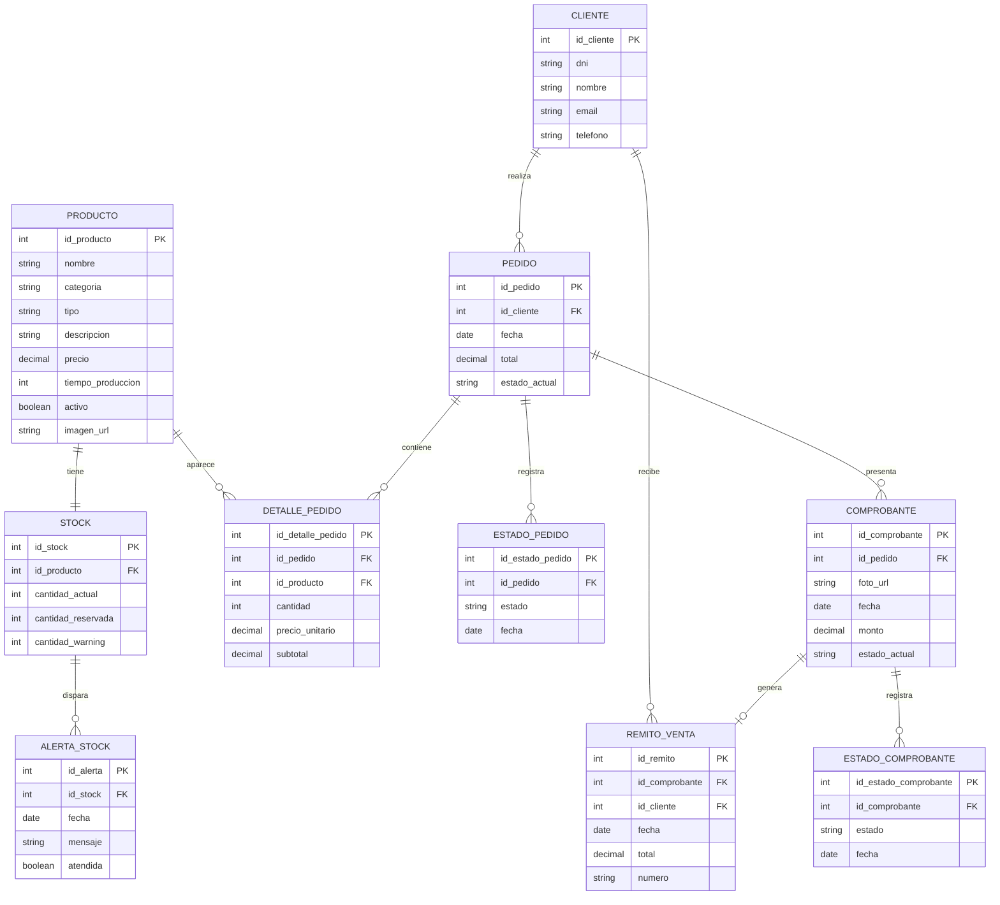
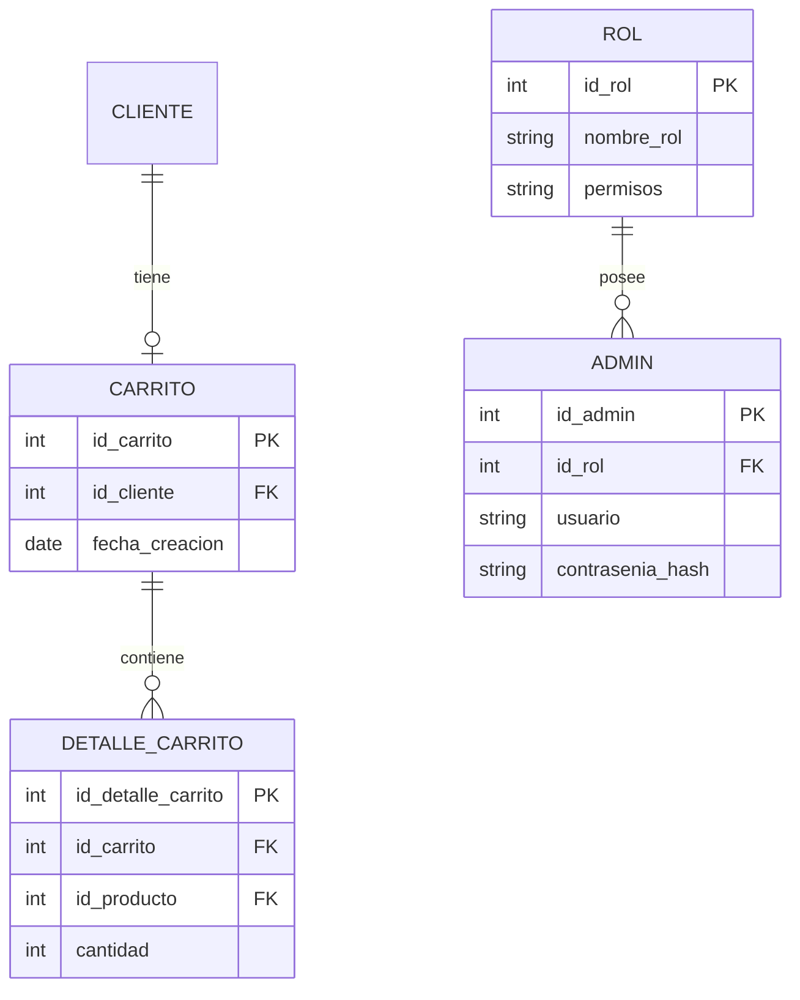

# Diagrama Entidad-Relación (DER) · Esencia Técnica

> **Proyecto:** Esencia Técnica — E-Commerce de Cosmética y Higiene (E.E.S.T N°1 Luciano Reyes).  
> **Cátedra:** Alejandro Nieva, Cecilia Maldonado, Ariel Leibouski.  
> **Entrega:** Entregable Académico de Cierre Beta ([`docs/specs/cierre-beta/spec.md`](../specs/cierre-beta/spec.md)).  
> **Fuentes de verdad:** [`docs/MODELO.md`](../MODELO.md) · [`docs/estado/AUDITORIA_BD.md`](../estado/AUDITORIA_BD.md) · [`GLOSSARY.md`](../../GLOSSARY.md).  
> **Responsables:** Isabella Infante (SQL / DDL) y Juan Manuel Merodio (Arquitectura).  
> **Estado:** Formalizado en Mermaid, 100% normalizado en 3FN y en concordancia con la base viva (`otjph…`).

---

## 1. Introducción y Resolución del Borrador Histórico

El borrador preliminar en formato CSV ([`DER-quimica.csv`](DER-quimica.csv)) representó la primera aproximación al modelado de datos del proyecto. Sin embargo, presentaba discrepancias con las buenas prácticas de normalización relacional y desajustes respecto al código operativo en producción:

1. **Inversión y Circularidad de Claves Foráneas:**
   - *Borrador preliminar:* Colocaba `id_stock` en la tabla de productos y simultáneamente `id_producto` en stock. Lo mismo sucedía entre pedidos y comprobantes.
   - *Resolución canónica:* Una sola dirección por relación jerárquica. La tabla `STOCK` almacena la clave foránea `id_producto` referenciando a `PRODUCTO`. La tabla `COMPROBANTE` referencia a `PEDIDO`.
2. **Diferenciación entre Estado Actual e Historial de Auditoría:**
   - *Borrador preliminar:* Intentaba almacenar un único campo de estado sin preservar la trazabilidad temporal.
   - *Resolución canónica:* Modelo dual optimizado. `PEDIDO.estado_actual` y `COMPROBANTE.estado_actual` permiten lectura directa en el panel de control, mientras que las tablas `ESTADO_PEDIDO` y `ESTADO_COMPROBANTE` auditan cada cambio en la misma transacción atómica con su timestamp.
3. **Tipificación Financiera Estricta:**
   - *Borrador preliminar:* Utilizaba tipos genéricos `int(200)` o `varchar` para precios y montos.
   - *Resolución canónica:* Toda cifra monetaria se modela como `NUMERIC(12,2)` en PostgreSQL con restricciones `CHECK (precio > 0)` y `CHECK (monto > 0)`.
4. **Frontera Nítida entre Fase 1 (MVP) y Fase 2:**
   - *Resolución de cátedra:* Se formaliza el DER del MVP con 10 entidades activas en la base `otjph…`. Las entidades de usuarios administrativos (`ADMIN`, `ROL`) y carrito persistente (`CARRITO`, `DETALLE_CARRITO`) quedan explícitamente delimitadas como extensiones de Fase 2.

---

## 2. Diagrama Entidad-Relación en Mermaid (MVP · Fase 1)

---

## 3. Diccionario de Entidades y Reglas de Integridad

### 3.1. `CLIENTE`
Comprador invitado en la tienda. No requiere registro previo ni contraseña en el MVP.
- `id_cliente` (SERIAL / PK): Identificador autoincremental.
- `dni` (VARCHAR(15)): DNI o identificación para facturación y entrega.
- `nombre` (VARCHAR(100)): Nombre completo del destinatario.
- `email` (VARCHAR(150)): Dirección de correo para la recepción del remito.
- `telefono` (VARCHAR(30)): Teléfono celular de contacto.

### 3.2. `PRODUCTO`
Catálogo de formulaciones cosméticas elaboradas en el taller de Química.
- `id_producto` (SERIAL / PK): Identificador del producto.
- `nombre` (VARCHAR(100)): Nombre comercial (ej. Alcohol en Gel Neutro).
- `categoria` (VARCHAR(50)): Categoría taxonómica (Jabones, Cuidado Capilar, Aromaterapia).
- `tipo` (VARCHAR(50)): Clasificación cosmética interna.
- `descripcion` (TEXT): Fórmula, propiedades y modo de empleo.
- `precio` (NUMERIC(12,2)): Precio unitario en ARS (`precio > 0`).
- `tiempo_produccion` (INT): Días requeridos para maceración o envasado.
- `activo` (BOOLEAN): Flag de baja lógica (`true` = exhibido en catálogo; `false` = deshabilitado).
- `imagen_url` (VARCHAR(255)): URL pública de la imagen en Supabase Storage.

### 3.3. `STOCK`
Inventario físico y gestión de reservas por compras concurrentes.
- `id_stock` (SERIAL / PK): Identificador del registro.
- `id_producto` (INT / FK): Vínculo uno a uno con `PRODUCTO`.
- `cantidad_actual` (INT): Stock físico en estantería (`>= 0`).
- `cantidad_reservada` (INT): Unidades bloqueadas en pedidos `Pendiente de Pago` (`>= 0`).
- `cantidad_warning` (INT): Umbral mínimo para el disparo de alertas visuales.
- **Invariante de integridad (`ET007`):** La base de datos garantiza que `cantidad_actual >= cantidad_reservada` en todo momento.

### 3.4. `PEDIDO`
Orden de compra efectuada por el cliente.
- `id_pedido` (SERIAL / PK): Identificador unívoco del pedido.
- `id_cliente` (INT / FK): Referencia al comprador en `CLIENTE`.
- `fecha` (TIMESTAMPTZ): Momento de creación.
- `total` (NUMERIC(12,2)): Importe total (`total > 0`), derivado de la suma de subtotales.
- `estado_actual` (VARCHAR(30)): Estado canónico (`Pendiente de Pago`, `Pago Validado`, `Rechazado`, `Cancelado`).

### 3.5. `DETALLE_PEDIDO`
Líneas de artículos solicitados con precio congelado al instante de la compra.
- `id_detalle_pedido` (SERIAL / PK): Clave primaria.
- `id_pedido` (INT / FK): Vínculo con `PEDIDO` (`ON DELETE CASCADE`).
- `id_producto` (INT / FK): Vínculo con `PRODUCTO`.
- `cantidad` (INT): Cantidad adquirida (`cantidad > 0`).
- `precio_unitario` (NUMERIC(12,2)): Precio congelado al confirmar el pedido.
- `subtotal` (NUMERIC(12,2)): `cantidad * precio_unitario`.

### 3.6. `ESTADO_PEDIDO`
Auditoría cronológica inmutable de las transiciones del pedido.
- `id_estado_pedido` (SERIAL / PK): Clave primaria.
- `id_pedido` (INT / FK): Vínculo con `PEDIDO`.
- `estado` (VARCHAR(30)): Valor del estado asignado.
- `fecha` (TIMESTAMPTZ): Timestamp del cambio de estado.

### 3.7. `COMPROBANTE`
Evidencia de transferencia bancaria aportada por el cliente.
- `id_comprobante` (SERIAL / PK): Clave primaria.
- `id_pedido` (INT / FK): Vínculo con `PEDIDO`.
- `foto_url` (VARCHAR(255)): Ruta/clave del comprobante en el bucket privado.
- `fecha` (TIMESTAMPTZ): Fecha y hora de subida.
- `monto` (NUMERIC(12,2)): Importe transferido informado por el cliente (`monto > 0`).
- `estado_actual` (VARCHAR(30)): Estado canónico (`Comprobante Subido`, `Aprobado por Admin`, `Rechazado`).

### 3.8. `ESTADO_COMPROBANTE`
Auditoría de las revisiones realizadas por los Administradores de Química.
- `id_estado_comprobante` (SERIAL / PK): Clave primaria.
- `id_comprobante` (INT / FK): Vínculo con `COMPROBANTE`.
- `estado` (VARCHAR(30)): Estado registrado.
- `fecha` (TIMESTAMPTZ): Timestamp de la validación.

### 3.9. `REMITO_VENTA`
Comprobante legal de entrega de mercadería emitido por el sistema.
- `id_remito` (SERIAL / PK): Clave primaria.
- `id_comprobante` (INT / FK): Vínculo 1 a 1 con el comprobante que originó la venta.
- `id_cliente` (INT / FK): Vínculo con el cliente que retira el pedido.
- `fecha` (TIMESTAMPTZ): Momento de emisión tras la aprobación del pago.
- `total` (NUMERIC(12,2)): Monto de la operación validada.
- `numero` (VARCHAR(30)): Número correlativo formateado (ej. `R-2026-000001`).

### 3.10. `ALERTA_STOCK`
Notificación interna generada ante inventario en o por debajo del umbral mínimo.
- `id_alerta` (SERIAL / PK): Clave primaria.
- `id_stock` (INT / FK): Vínculo con el registro de inventario en `STOCK`.
- `fecha` (TIMESTAMPTZ): Momento en que se disparó la alerta.
- `mensaje` (TEXT): Descripción operativa (ej. `Stock bajo: Jabón Líquido (quedan 2 unidades)`).
- `atendida` (BOOLEAN): Indicador de gestión por parte del Administrador en `/admin`.

---

## 4. Extensión para Fase 2 (Fuera del Alcance del MVP)

Conforme a [`docs/MODELO.md`](../MODELO.md) §5, las siguientes entidades se encuentran diseñadas y contempladas en el modelo relacional teórico de cátedra, pero **no** forman parte del alcance del MVP de este repositorio:

- **Carrito en Cliente:** En el MVP, el carrito reside íntegramente en el navegador del cliente (`localStorage` / cookies), prescindiendo de tablas en base de datos.
- **Autenticación del Administrador:** El acceso al panel `/admin` se valida a nivel de infraestructura HTTP mediante Basic Auth con `ADMIN_PASSWORD` en el Edge Middleware (ADR 0005), evitando almacenamiento de contraseñas o tablas de permisos en la base de datos hasta la Fase 2.
