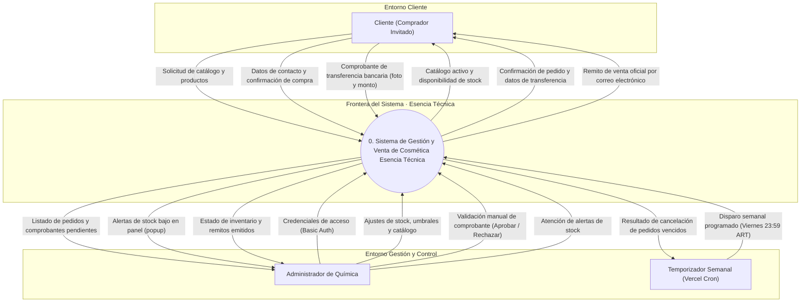
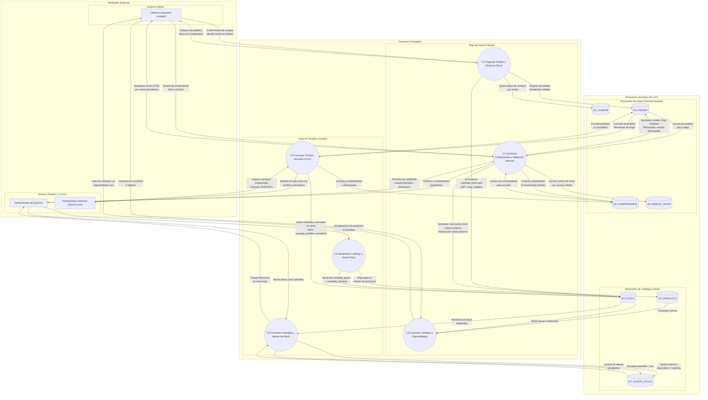
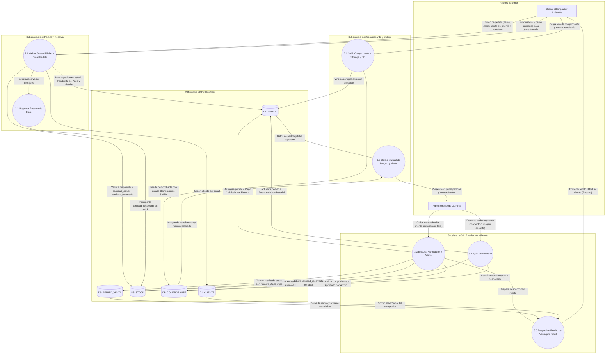
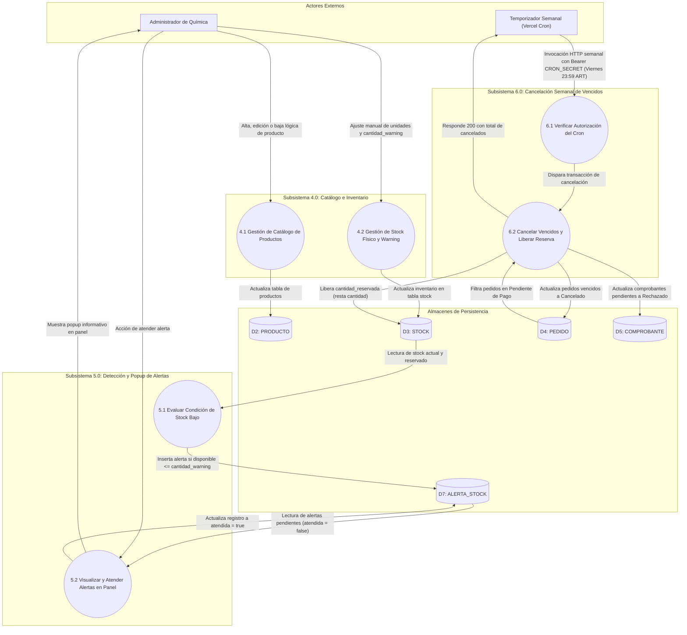
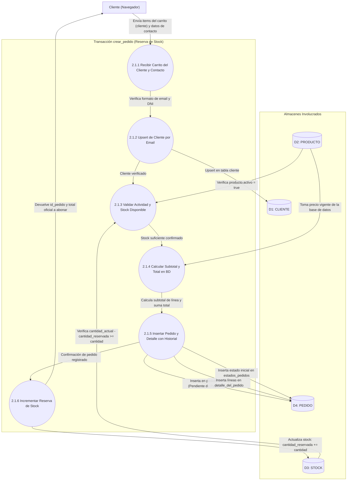
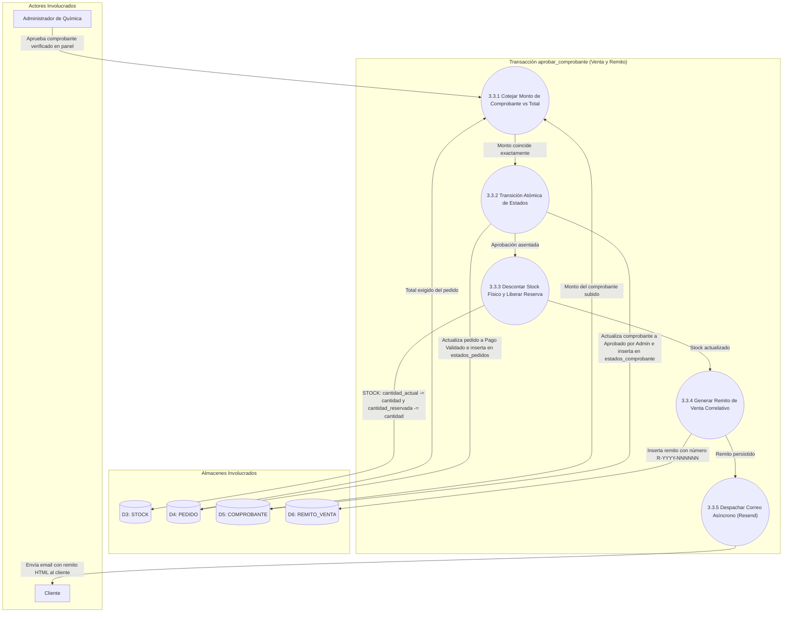
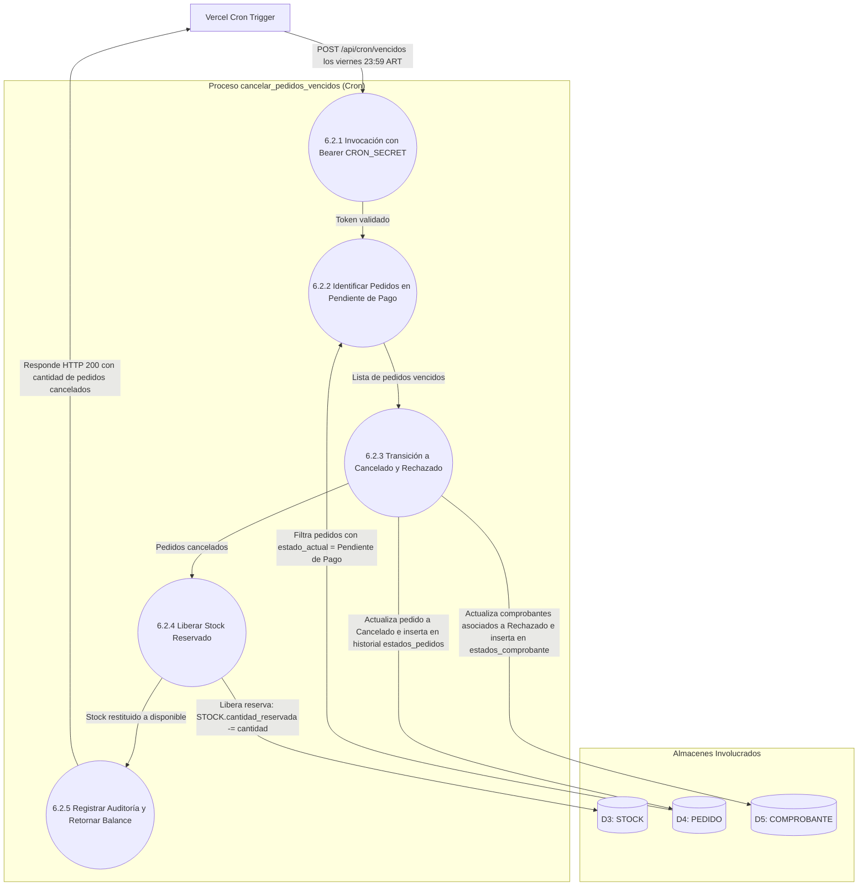
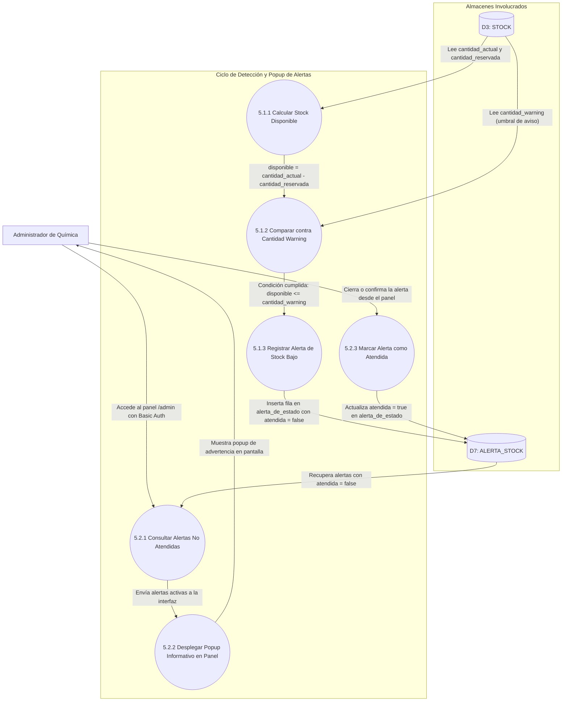

# Diagramas de Flujo de Datos (DFD) · Esencia Técnica

> **Proyecto:** Esencia Técnica — E-Commerce de Cosmética y Higiene (E.E.S.T N°1 Luciano Reyes).  
> **Cátedra:** Ariel Leibouski, Cecilia Maldonado, Alejandro Nieva.  
> **Entrega:** HU-15 del Spec Maestro de Cierre Beta ([`docs/specs/cierre-beta/spec.md`](../specs/cierre-beta/spec.md)).  
> **Fuentes de verdad:** [`docs/MODELO.md`](../MODELO.md) · [`GLOSSARY.md`](../../GLOSSARY.md) · [`docs/specs/cierre-beta/spec.md`](../specs/cierre-beta/spec.md).  
> **Responsables:** Celeste Cáceres (QA / Docs) y Juan Manuel Merodio (Arquitectura).  
> **Estado:** Aprobado para cátedra, formalizado en Mermaid y sincronizado con la base viva (`otjph…`).

---

## 1. Introducción y Resolución de Observaciones Docentes (Ariel)

Los borradores preliminares desarrollados en formato CSV ([`DFD1-Quimica.csv`](DFD1-Quimica.csv), [`DFD2-Quimica.csv`](DFD2-Quimica.csv) y [`DFD3-Quimica.csv`](DFD3-Quimica.csv)) contenían inconsistencias estructurales con la teoría de análisis de sistemas y desajustes respecto al modelo de datos canónico del sistema. En este documento se corrigen de forma integral dichas observaciones:

1. **Corrección de Nivel 0 (Diagrama de Contexto):**
   - *Observación:* El borrador anterior incluía un almacén denominado "Base de datos" conectado al proceso central.
   - *Corrección metodológica:* En el Diagrama de Contexto (Nivel 0) **no se admiten almacenes de datos**. Toda la persistencia es interna a la frontera del sistema. El Nivel 0 modela estrictamente a las entidades externas (Cliente, Administrador de Química y el Temporizador del Cron Semanal) interactuando con el proceso único del sistema.
2. **Definición de Almacenes Canónicos D1 a D7 vs. "Base de datos" genérica:**
   - *Observación:* Los diagramas de niveles 1 y 2 representaban una base de datos monolítica no estructurada.
   - *Corrección metodológica:* Se identifican formalmente los 7 almacenes de datos canónicos normalizados definidos en [`docs/MODELO.md`](../MODELO.md):
     - **D1: CLIENTE** (compradores invitados, DNI, datos de contacto).
     - **D2: PRODUCTO** (catálogo activo, descripción, precio, categoría).
     - **D3: STOCK** (cantidades actuales, reservadas y umbrales de aviso).
     - **D4: PEDIDO** (cabecera, detalle de productos e historial de estados).
     - **D5: COMPROBANTE** (imagen en Storage privado, montos e historial de estados).
     - **D6: REMITO_VENTA** (remitos emitidos correlativos con vinculación a cliente y comprobante).
     - **D7: ALERTA_STOCK** (avisos de stock mínimo registrados para el panel).
3. **El Carrito reside en el Cliente (Sin persistencia en BD en el MVP):**
   - *Observación:* El borrador Nivel 3 planteaba un proceso "Registrar carrito", un almacén "carrito" y tablas de carrito persistente en base de datos.
   - *Corrección de dominio:* Conforme a [`docs/MODELO.md`](../MODELO.md) §1 y §5, en el MVP el Carrito vive pura y exclusivamente en el navegador del cliente (`localStorage` / cookies). El Carrito **no es un almacén de base de datos** y no reserva stock por sí mismo. La reserva ocurre únicamente cuando el cliente confirma la compra y se crea el Pedido en la base de datos.
4. **Ciclo de Reserva y Cancelación Semanal de Vencidos (Cron de los Viernes 23:59 ART):**
   - *Observación:* El borrador indicaba erróneamente que `cantidades_reservadas` "se iba sumando semanalmente si la compra no fue ejecutada" y proponía temporizadores diarios arbitrarios.
   - *Corrección de dominio:* La reserva (`STOCK.cantidad_reservada`) se incrementa al confirmar el pedido. El proceso temporizado semanal de los **viernes 23:59 ART** (`cancelar_pedidos_vencidos`) **cancela** los pedidos sin comprobante aprobado y **libera la reserva** (`cantidad_reservada -= cantidad`), devolviendo las unidades al stock disponible. No se utilizan temporizadores diarios ni ventanas cortas.
5. **Canal de Alertas de Stock (Popup en Panel `/admin`, sin emails):**
   - *Observación:* El borrador sugería el envío de emails ante alertas de stock.
   - *Corrección de dominio:* Las alertas de stock se notifican de manera visual exclusiva mediante un popup en el panel `/admin` (`ALERTA_STOCK`). El correo electrónico se reserva exclusivamente para el despacho del Remito de venta al Cliente.

---

## 2. Nivel 0 · Diagrama de Contexto

El Nivel 0 delimita la frontera del sistema de Esencia Técnica frente a sus entidades externas. No contiene almacenes de datos internos.

---

## 3. Nivel 1 · Descomposición General del Sistema

El Nivel 1 descompone el sistema central en seis procesos principales y expone los siete almacenes de datos canónicos (D1 a D7). Se explicita que el carrito reside en el cliente y no en la base de datos.

---

## 4. Nivel 2 · Descomposición de Subsistemas Clave

### 4.1 Subsistema de Pedidos, Comprobantes y Remitos (Descomposición de 2.0 y 3.0)

Este diagrama detalla cómo interactúan la creación de pedidos, el registro de comprobantes en storage privado y la validación manual por parte del Administrador.

### 4.2 Subsistema de Stock, Alertas y Cron Semanal (Descomposición de 4.0, 5.0 y 6.0)

Este diagrama detalla la administración del inventario, la generación de alertas en el panel y la cancelación de pedidos vencidos por cron semanal.

---

## 5. Nivel 3 · Detalle Transaccional de Procesos Críticos

El Nivel 3 realiza la explosión de las transacciones atómicas más importantes del e-commerce:

### 5.1 Transacción Atómica de Creación de Pedido con Reserva (`crear_pedido`)

Explosión detallada del proceso 2.1 / 2.2. Garantiza que no se sobrevenda stock disponible.

### 5.2 Transacción Atómica de Validación Manual y Emisión de Remito (`aprobar_comprobante`)

Explosión detallada del proceso 3.2 / 3.3. Representa el hito final de venta del MVP.

### 5.3 Proceso Automático del Cron Semanal (`cancelar_pedidos_vencidos`)

Explosión detallada del proceso 6.0. Cancela pedidos pendientes de pago los viernes por la noche y devuelve el stock al catálogo.

### 5.4 Ciclo de Detección y Notificación de Alertas de Stock

Explosión detallada del proceso 5.0.

---

## 6. Trazabilidad con el Modelo de Datos y Reglas de Dominio

| Componente del DFD | Tabla Física en Supabase | Regla de Dominio ([`docs/MODELO.md`](../MODELO.md)) |
|---|---|---|
| **D1: CLIENTE** | `cliente` | Identificación por `email` (único en minúsculas) y `dni` válido. |
| **D2: PRODUCTO** | `producto` | Cosmética/higiene (`precio > 0`). Baja lógica con `activo = false`. |
| **D3: STOCK** | `stock` | `disponible = cantidad_actual - cantidad_reservada`. Umbral en `cantidad_warning`. |
| **D4: PEDIDO** | `pedido`, `detalle_del_pedido`, `estados_pedidos` | `total = SUM(subtotal)`. Estados: `Pendiente de Pago`, `Pago Validado`, `Rechazado`, `Cancelado`. |
| **D5: COMPROBANTE** | `comprobante`, `estados_comprobante` | `monto > 0` coincidente con total. Estados: `Comprobante Subido`, `Aprobado por Admin`, `Rechazado`. |
| **D6: REMITO_VENTA** | `remitos_de_venta` | Documento final del MVP emitido al aprobar pago (`R-YYYY-NNNNNN`). Encriptado y enviado por Resend. |
| **D7: ALERTA_STOCK** | `alerta_de_estado` | Popup en `/admin` cuando `disponible <= cantidad_warning`. Sin correos electrónicos al Administrador. |
| **Carrito (Cliente)** | *Ninguna (localStorage / Cookies)* | El carrito no se persiste en BD en el MVP ni reserva stock por sí mismo. |
| **Cron Semanal** | RPC `cancelar_pedidos_vencidos()` | Ejecución los viernes 23:59 ART (`America/Argentina/Buenos_Aires`). Libera reserva y cancela pedidos impagos. |
