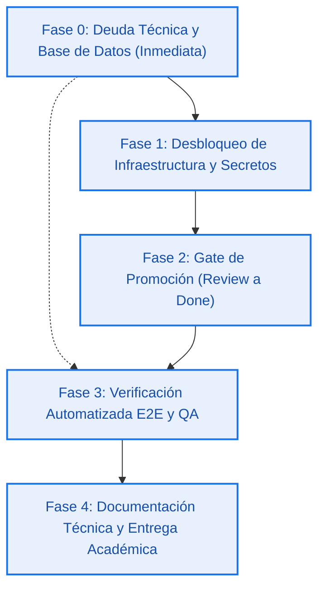

# Plan de Ejecución Secuencial: Cierre Integral de la Beta y Entrega Académica

> **Feature:** Hoja de Ruta de Ejecución Secuencial de las 14 tareas restantes del tablero Teams.  
> **Estado:** Especificada (`ready-for-agent`).  
> **Fecha:** 2026-10-30.  
> **Issue:** [#53](https://github.com/juanmamerodio/esenciatecnica/issues/53) y [#1](https://github.com/juanmamerodio/esenciatecnica/issues/1).  
> **Origen:** Entrevista interactiva de arquitectura (`/grill-me`) y consolidación de las 14 tareas pendientes (11 backlog + 3 review) del tablero de Teams (`uchy…`).  
> **Fuente de verdad:** [`AGENTS.md`](../../../AGENTS.md) · [`docs/MODELO.md`](../../MODELO.md) · [`GLOSSARY.md`](../../../GLOSSARY.md) · [`memory.md`](../../../memory.md).  
> **Responsables del plan:** Juan Manuel Merodio (Full-Stack/Arquitectura), Enzo Queipo (Backend/Infra), Isabella Infante (BD/DDL), Celeste Cáceres (QA/Docs).  
> **Criterio de cierre del plan:** Las 14 tareas del tablero promovidas a `done` con evidencia auditable, suite CI en 100% verde (507+ tests, 0 lint, 0 typecheck, 0 links rotos, build limpio), verificación E2E registrada y paquete de manuales y presentación de la Expo completo.

---

## 1. Declaración del Problema (Problem Statement)

El sistema de e-commerce de **Esencia Técnica** se encuentra operativo en producción (`esenciatecnica.vercel.app`) y respaldado por la base viva `otjph…` con más de 500 pruebas automatizadas en verde y la formalización de diagramas en Mermaid finalizada en el Hub. Sin embargo, el cierre definitivo del proyecto y su presentación ante la cátedra permanecen abiertos debido a la dispersión de **14 tareas pendientes en el tablero de Teams**:

1. **Deuda técnica remanente en el repositorio:** Existen detalles de juicio pendientes de la auditoría de estándares del 28-10 (nombres de módulos, conmutadores solapados de errores, captura silenciosa de excepciones y pruebas frágiles) y la verificación documental de `respaldo_legacy` en base viva sin asentar en GitHub.
2. **Dependencias operativas externas en vivo:** Tres tareas de backend se encuentran retenidas en estado `review` porque requieren variables de entorno vivas en Vercel (`CRON_SECRET`, datos bancarios oficiales `NEXT_PUBLIC_TRANSFERENCIA_*`) y la resolución del dominio verificado en Resend para el despacho real del Remito de venta.
3. **Falta de unificación en el protocolo de QA:** Las tareas de verificación en navegador (`B6`), plan de pruebas y bitácora de testing se encuentran disgregadas en tareas individuales sin un script ejecutable que trace de manera sistemática y reproducible el flujo completo de compra y administración.
4. **Entregables académicos y manuales pendientes:** La documentación de uso y desarrollo, así como la presentación formal para la EXPO TEC1, carecen de guiones y manuales definitivos consolidados en el repositorio.

---

## 2. Solución Propuesta (Solution)

Se define un **Plan Maestro de Ejecución Secuencial** estructurado en **5 fases ordenadas por dependencias críticas**, asumiendo desde el agente la ejecución técnica, la automatización del QA y la redacción documental:

1. **Fase 0 · Deuda Técnica y Base de Datos (Inmediata en código):**
   - Resolver los ítems pendientes de la revisión de estándares del 28-10 (simplificación de `describirError`, saneamiento de `TABLAS_FASE_2`, eliminación de redundancias en `evaluarRpc`, robustez en capturas y refactor de nombres).
   - Ejecutar la verificación de `respaldo_legacy` y dejar asentados los conteos para cerrar los tickets #15 y #16.
2. **Fase 1 · Desbloqueo de Infraestructura y Secretos (Enzo):**
   - Configuración en Vercel de los datos bancarios oficiales de la Cooperadora (`NEXT_PUBLIC_TRANSFERENCIA_*`) y `CRON_SECRET`.
   - Gestión y verificación del dominio institucional en Resend para autorizar envíos de producción.
3. **Fase 2 · Gate de Promoción de Tareas en Review:**
   - Promoción con evidencia de las 3 tareas retenidas (`Automatización de comprobantes/remito`, `Secretos y entorno`, y `Cron de los viernes`).
4. **Fase 3 · Verificación Automatizada E2E y QA:**
   - Desacople progresivo: ejecución del recorrido completo mediante un script ejecutable autónomo (`scripts/verificar-e2e.mjs`) que prueba catálogo, carrito, checkout, comprobante, aprobación en `/admin`, emisión de remito y popup de alerta de stock.
   - Generación formal del reporte y matriz en `docs/testing/PLAN_DE_PRUEBAS.md` y registro en las tareas de Teams `B6` y `Testeo`.
   - Ratificación de las fotografías actuales como conjunto válido de demostración de la beta hasta su reemplazo con fotos de laboratorio físico.
5. **Fase 4 · Documentación Técnica y Entrega Académica:**
   - Confección del manual integral en `docs/MANUAL_DE_USO_Y_DESARROLLO.md`.
   - Elaboración del guión y estructura de diapositivas para la EXPO TEC1 en `docs/academico/PRESENTACION_EXPO_TEC1.md`.

---

## 3. Historias de Usuario (User Stories)

### Fase 0: Deuda Técnica y Base de Datos

1. **Como desarrollador del proyecto**, quiero que los conmutadores de `describirError` en los módulos de administración y checkout no presenten casos solapados sobre `motivoDeBd()`, para garantizar mensajes claros y sin ambigüedad ante fallas de base de datos.
2. **Como desarrollador del proyecto**, quiero que el arreglo de tablas de Fase 2 en la auditoría de superficie no utilice filtros innecesarios sobre listas fijas, para mantener el código directo y legible.
3. **Como desarrollador del proyecto**, quiero unificar las ramas de respuesta 404 en la evaluación de RPC de `bd:viva`, para evitar duplicación de lógica de inspección.
4. **Como desarrollador del proyecto**, quiero que las funciones auxiliares de prueba no dupliquen utilidades de extracción de códigos de error de PostgREST, para evitar discrepancias de tipos.
5. **Como desarrollador del proyecto**, quiero renombrar el módulo de operaciones monetarias para reflejar su responsabilidad de dominio en lugar de solo formateo visual, alineándolo con los principios de diseño de software.
6. **Como auditor de seguridad y estabilidad**, quiero que las funciones comunes de captura capturen y registren apropiadamente los errores inesperados, evitando bloques de captura ciegos.
7. **Como administradora de base de datos**, quiero ejecutar la consulta de verificación sobre `respaldo_legacy.conteos` en el editor SQL de `otjph…`, para certificar y cerrar formalmente los tickets de migración #15 y #16.

### Fase 1: Infraestructura y Secretos

8. **Como Cliente de la tienda**, quiero visualizar en el checkout el CBU, Alias, Titular y Banco oficiales de la Cooperadora, para poder realizar la transferencia bancaria con confianza y exactitud.
9. **Como operador de infraestructura**, quiero que la variable `CRON_SECRET` esté cargada en los entornos de Preview y Producción de Vercel, para habilitar la ejecución programada y manual del cron semanal.
10. **Como operador de correo**, quiero que el dominio institucional esté verificado con SPF y DKIM en Resend y sus credenciales cargadas en Vercel, para desbloquear el despacho de Remitos de venta fuera del modo sandbox.

### Fase 2: Promoción de Tareas en Review

11. **Como Administrador del sistema**, quiero verificar en vivo que el endpoint del cron de los viernes responda 200 y cancele pedidos vencidos liberando stock, para promover la tarea `cf2285f5` a estado `done`.
12. **Como equipo de desarrollo**, quiero comprobar que `/admin` autentique de manera segura y que un correo de prueba de Resend llegue a destino, para promover la tarea de secretos y entorno `40ede00d` a estado `done`.
13. **Como equipo de desarrollo**, quiero corroborar que la aprobación de comprobante despache el Remito de venta oficial sin bloquear la transacción, para promover la tarea `d028b233` a estado `done`.

### Fase 3: Protocolo de QA y Verificación de Punta a Punta

14. **Como responsable de aseguramiento de calidad (QA)**, quiero disponer de un script de verificación E2E que ejecute de forma programática las etapas del flujo de compra y administración, para obtener resultados objetivos y reproducibles sin depender de intervenciones manuales repetitivas.
15. **Como responsable de QA**, quiero que el script valide que el catálogo exponga stock y fotos activas, para asegurar la correcta navegación del cliente.
16. **Como responsable de QA**, quiero que el script valide la persistencia de productos en el carrito y la aplicación de los topes de stock disponible, para prevenir reservas que superen la disponibilidad.
17. **Como responsable de QA**, quiero que el script confirme la creación del pedido con estado inicial `Pendiente de Pago` y el incremento de `cantidad_reservada`, para verificar la integridad del modelo transaccional.
18. **Como responsable de QA**, quiero que el script simule la carga de un comprobante con monto coincidente y verifique su pasaje a `Comprobante Subido`, para certificar la recepción del pago.
19. **Como responsable de QA**, quiero que el script verifique que la aprobación en `/admin` descuente el stock real (`cantidad_actual`), libere la reserva y asiente el estado `Pago Validado` en una misma transacción, para certificar la consistencia del inventario.
20. **Como responsable de QA**, quiero que el script verifique la emisión del remito oficial de venta con identificador correlativo único, para constatar el cumplimiento del alcance de entrega del MVP.
21. **Como responsable de QA**, quiero que el script constate la aparición de la alerta de stock en el panel de `/admin` cuando un producto queda con stock igual o inferior al mínimo, para verificar la notificación operativa.
22. **Como equipo de desarrollo**, quiero documentar los resultados del script y la matriz de prueba completa en `docs/testing/PLAN_DE_PRUEBAS.md`, para dejar constancia formal del control de calidad.
23. **Como equipo de desarrollo**, quiero ratificar en el tablero que las fotos actuales de la semilla constituyen el conjunto oficial de la beta, para cerrar la tarea `bede4513` sin bloquear el avance ante la espera de fotos físicas del taller.

### Fase 4: Documentación y Entrega Académica

24. **Como usuario final o administrador de Química**, quiero contar con un Manual de Uso detallado que explique paso a paso cómo comprar y cómo validar pedidos en `/admin`, para operar el sistema con autonomía.
25. **Como docente evaluador o futuro mantenedor**, quiero contar con una Guía de Arquitectura y Desarrollo que detalle la estructura técnica, decisiones de diseño, scripts de auditoría y comandos de CI, para asegurar la continuidad del proyecto.
26. **Como alumno expositor en la EXPO TEC1**, quiero disponer de un guión de presentación estructurado por diapositivas, con argumentos de valor, descripción técnica, demostración en vivo y referencias a los diagramas Mermaid, para defender el proyecto con excelencia ante la comunidad educativa.

---

## 4. Decisiones de Implementación (Implementation Decisions)

### 4.1. Módulos y Refactorizaciones de la Fase 0
- **Mapeo y saneamiento de errores:** Consolidar la lógica de `describirError` en los módulos de API para eliminar solapamientos en la inspección de motivos de Postgres, manteniendo mensajes canónicos y amigables.
- **Limpieza de listas en auditoría viva:** Reemplazar el filtrado dinámico de `TABLAS_FASE_2` por un conjunto constante inmutable.
- **Unificación de respuestas 404 en RPC:** Consolidar en una única vía de inspección las comprobaciones de inexistencia o inaccesibilidad de RPC en la herramienta de evaluación de superficie viva.
- **Redefinición del módulo monetario:** Renombrar conceptualmente las funciones de redondeo y aritmética de centavos para denotar lógica de negocio de dinero y no meros formateadores de texto.
- **Tratamiento estricto de excepciones:** Garantizar que todo bloque `catch` registre la traza del error antes de adoptar una ruta alternativa o fallback.

### 4.2. Secuencia de Desbloqueo Operativo (Fase 1 y 2)
- **Desacople de secretos:** La carga de datos bancarios (`NEXT_PUBLIC_TRANSFERENCIA_*`) y `CRON_SECRET` se realiza de forma independiente a la compra del dominio, permitiendo que el checkout y el cron semanal se validen de inmediato.
- **Criterio de promoción de tareas en review:** Ninguna tarea pasa de `review` a `done` sin una nota de auditoría que incluya la respuesta HTTP o el identificador de ejecución real obtenido en el entorno vivo.

### 4.3. Automatización de Pruebas E2E (Fase 3)
- **Script autónomo de verificación:** Se construirá un script en Node.js ESM (`scripts/verificar-e2e.mjs`) que consumirá las credenciales del entorno y ejecutará una prueba sintética completa de compra sin navegadores gráficos pesados (Playwright/Puppeteer), garantizando portabilidad, velocidad e independencia de dependencias nativas complejas.
- **Matriz de validación documental:** Los casos de prueba se estructuran formalmente bajo el estándar Gherkin (Given-When-Then) en `docs/testing/PLAN_DE_PRUEBAS.md`.

### 4.4. Entregables Documentales y Académicos (Fase 4)
- **Manual consolidado:** Se creará un único manual profundo en `docs/MANUAL_DE_USO_Y_DESARROLLO.md` con dos secciones principales: Operación (Cliente y Administrador) y Arquitectura/Desarrollo (CI, RLS, Storage y APIs).
- **Guión para la Expo:** En `docs/academico/PRESENTACION_EXPO_TEC1.md` se estructurará la presentación en 10 bloques temáticos, integrando los diagramas Mermaid ya existentes en el Hub y estableciendo la guía para el diseño en Canva y póster impreso.

---

## 5. Decisiones de Testing (Testing Decisions)

### 5.1. Seams de Verificación
1. **Seam de Aritmética y Errores (Unitario):** Pruebas en Vitest que verifican las conmutaciones de error, funciones monetarias y utilidades de postgrest falso.
2. **Seam de Integración en Memoria (PGlite):** Ejecución de las transacciones de compra, aprobación, cancelación por vencimiento y alertas de stock en base local sin red.
3. **Seam de Superficie de Red (E2E):** Ejecución del script `verificar-e2e.mjs` invocando los route handlers del servidor y constatando las respuestas HTTP y el estado resultante en la base de datos viva.
4. **Seam de Integridad Documental:** Verificación mediante `npm run docs:links` asegurando que todos los nuevos documentos markdown posean enlaces internos y cruzados 100% resolubles.

### 5.2. Lo que no se testea
- No se testean estilos CSS píxel a píxel ni micro-animaciones del front.
- No se simula la entrega física de productos (fuera del alcance del MVP).
- No se interceptan conexiones de red simuladas con mocks frágiles: las pruebas locales se realizan contra PGlite y las pruebas E2E contra la API real.

### 5.3. Prior Art en el Repositorio
- `tests/front/cron.test.ts`: Validación de lógica de vencimiento y respuestas HTTP del cron.
- `tests/front/checkout.test.ts`: Verificación de creación de pedidos y manejo de errores.
- `tests/front/admin.test.ts`: Contratos de aprobación y rechazo de comprobantes.
- `tests/front/bd-viva-reglas.test.ts`: Reglas de evaluación de superficie pública.

---

## 6. Fuera de Alcance (Out of Scope)

- Implementación de pasarelas de pago automatizadas (Mercado Pago, tarjetas de crédito/débito).
- Módulos de logística y seguimiento de envíos físicos (el MVP concluye formalmente con la entrega del Remito de venta para retiro presencial).
- Pantallas de autenticación con roles granulares de Fase 2 (ADR 0005 rige con Basic Auth para `/admin`).
- Reescritura del Hub o inclusión de dependencias de QuimicaShop dentro de `esenciatecnica`.

---

## 7. Mapeo Exhaustivo de las 14 Tareas de Teams

| # | ID de Tarea | Asignado | Tag | Prioridad | Estado Actual | Fase Asignada | Entregable / Criterio de Cierre |
|---|---|---|---|---|---|---|---|
| 1 | `5324ac47` | Juanma | BACKEND | BAJA | `backlog` | **Fase 0** | Saneamiento de deuda de estándares del 28-10 en código |
| 2 | `52e566f4` | Juanma | DATABASE | ALTA | `backlog` | **Fase 0** | Conteos de `respaldo_legacy` ejecutados y asentados en #16 |
| 3 | `8943632c` | Enzo | BACKEND | ALTA | `backlog` | **Fase 1** | Variables `NEXT_PUBLIC_TRANSFERENCIA_*` cargadas en Vercel |
| 4 | `a1f81278` | Enzo | BACKEND | MEDIA | `backlog` | **Fase 1** | Variable `CRON_SECRET` inyectada en Vercel y ruta probada |
| 5 | `3503c1ff` | Enzo | BACKEND | ALTA | `backlog` | **Fase 1** | Dominio institucional configurado y verificado en Resend |
| 6 | `cf2285f5` | Enzo | BACKEND | MEDIA | `review` | **Fase 2** | Promover a `done` tras comprobar cancelación real en vivo |
| 7 | `40ede00d` | Enzo | BACKEND | ALTA | `review` | **Fase 2** | Promover a `done` tras validar credenciales y correo de prueba |
| 8 | `d028b233` | Enzo | BACKEND | MEDIA | `review` | **Fase 2** | Promover a `done` tras validar emisión real del remito |
| 9 | `5823a2db` | Celeste / Juanma | DOCS | MEDIA | `backlog` | **Fase 3** | Matriz formal en `docs/testing/PLAN_DE_PRUEBAS.md` |
| 10 | `29509bd2` | Celeste / Juanma | FRONTEND | ALTA | `backlog` | **Fase 3** | Script `verificar-e2e.mjs` ejecutado y bitácora de B6 completa |
| 11 | `16878016` | Celeste / Juanma | FRONTEND | ALTA | `backlog` | **Fase 3** | Registro consolidado de validaciones en bitácora de testing |
| 12 | `bede4513` | Celeste | FRONTEND | ALTA | `backlog` | **Fase 3** | Ratificación de imágenes de catálogo y cierre de tarea |
| 13 | `da6b26f3` | Celeste / Juanma | DOCS | ALTA | `backlog` | **Fase 4** | Documento `docs/MANUAL_DE_USO_Y_DESARROLLO.md` completado |
| 14 | `b81c3468` | Celeste / Juanma | DOCS | MEDIA | `backlog` | **Fase 4** | Guión de exposición en `docs/academico/PRESENTACION_EXPO_TEC1.md` |

---

## 8. Orden Cronológico de Ejecución Recomendado

```mermaid
flowchart LR
    subgraph S0["Paso 1: Inmediato"]
        T1["5324ac47<br/>Deuda estándares"]
        T2["52e566f4<br/>Firma respaldo"]
    end

    subgraph S1["Paso 2: Infra"]
        T3["8943632c<br/>Datos banco"]
        T4["a1f81278<br/>CRON_SECRET"]
        T5["3503c1ff<br/>Dominio Resend"]
    end

    subgraph S2["Paso 3: Gate Review"]
        T6["cf2285f5<br/>Cron vivo"]
        T7["40ede00d<br/>Secretos"]
        T8["d028b233<br/>Remito vivo"]
    end

    subgraph S3["Paso 4: QA E2E"]
        T9["5823a2db<br/>Plan pruebas"]
        T10["29509bd2<br/>B6 E2E"]
        T11["16878016<br/>Bitácora test"]
        T12["bede4513<br/>Fotos beta"]
    end

    subgraph S4["Paso 5: Cierre Académico"]
        T13["da6b26f3<br/>Manual uso/dev"]
        T14["b81c3468<br/>Presentación Expo"]
    end

    S0 --> S1 --> S2 --> S3 --> S4
    S0 -.-> S3
```

1. **Paso 1 (Código y Base de Datos):** Resolver en `main` los ítems de deuda técnica de estándares del 28-10, validar la firma de `respaldo_legacy` y verificar que la suite local continúe en 100% verde (507+ tests).
2. **Paso 2 (Infraestructura y Secretos):** Cargar datos bancarios y `CRON_SECRET` en Vercel; coordinar verificación del dominio institucional en Resend.
3. **Paso 3 (Promoción en Tablero):** Validar en vivo cron, acceso administrativo y despacho de remito, moviendo las 3 tareas de `review` a `done`.
4. **Paso 4 (Automatización de QA y Fotos):** Crear `scripts/verificar-e2e.mjs`, ejecutar el recorrido punta a punta, plasmar resultados en `docs/testing/PLAN_DE_PRUEBAS.md` y asentar notas en `B6` y `Testeo`. Ratificar fotos de la semilla.
5. **Paso 5 (Documentación y Cátedra):** Redactar `docs/MANUAL_DE_USO_Y_DESARROLLO.md` y `docs/academico/PRESENTACION_EXPO_TEC1.md`, validar enlaces con `npm run docs:links` y publicar el avance definitivo en Teams.
